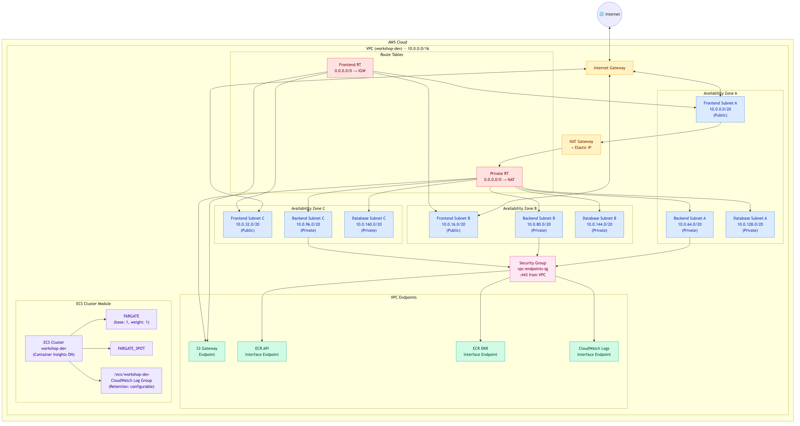
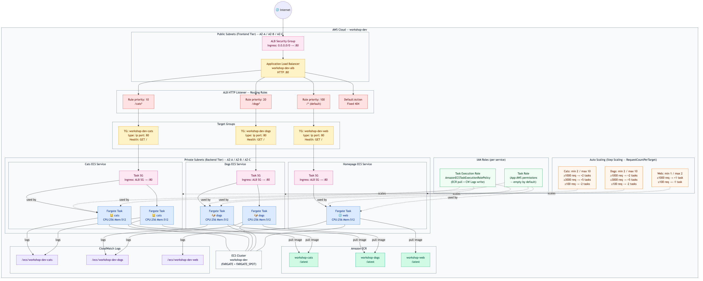

**English** | [한국어](workshop-claude-code-iac.md)

# AWS Infrastructure Management and Infrastructure as Code (IaC) Workshop with Claude Code

> **Duration:** About 3 hours  
> **Audience:** Beginner to intermediate engineers with AWS experience  
> **Goal:** Learn how to design, deploy, and optimize Terraform-based container infrastructure using Claude Code and Amazon Bedrock.

> [!NOTE]
> **Region change guide (if you run the lab in N. Virginia)**
>
> This workshop is written for **us-west-2 (Oregon)**. To run it in **us-east-1 (N. Virginia)**, change every item below to `us-east-1`:
>
> - Section 2.1: `export AWS_REGION="us-east-1"`
> - Section 3.1: `"AWS_REGION": "us-east-1"` in settings.json
> - Section 6.9: `aws_region = "us-east-1"` in terraform.tfvars (Availability Zones are selected automatically from the Region, so you do not need to change them)
> - Section 7.2: `--region us-east-1` in the ECR commands and `.ecr.us-east-1.amazonaws.com` in the ECR URIs
> - Section 7.7: `aws_region = "us-east-1"` in the app terraform.tfvars
>
> The model IDs (`global.anthropic.claude-*`) use cross-Region inference, so they do not need to change.

---

## Table of Contents

1. [Install Claude Code](#1-install-claude-code)
2. [Configure AWS Authentication](#2-configure-aws-authentication)
3. [Configure the Bedrock LLM](#3-configure-the-bedrock-llm)
4. [Create SKILL.md — AWS + Terraform + Container](#4-create-skillmd--aws--terraform--container)
5. [Connect MCP Servers](#5-connect-mcp-servers)
6. [Create and Deploy the Infrastructure with Terraform](#6-create-and-deploy-the-infrastructure-with-terraform) — VPC, ECS Cluster
7. [Create and Deploy the Container Application with Terraform](#7-create-and-deploy-the-container-application-with-terraform) — Cats & Dogs multi-service
8. [Cost Optimization and Architecture Improvements](#8-cost-optimization-and-architecture-improvements)

---

## 1. Install Claude Code

### 1.1 What is Claude Code?

Claude Code is an **agentic coding tool** developed by Anthropic. Unlike typical code autocomplete tools or chat sidebars, Claude Code runs directly in your terminal. It can access the file system, shell commands, and Git, and it carries out complex multi-step tasks on its own.

> Official docs: https://docs.anthropic.com/en/docs/claude-code/overview

**How it differs from traditional coding assistants:**

| Aspect | Code autocomplete (Copilot, etc.) | Claude Code |
|--------|-----------------------------------|-------------|
| How it works | Inline suggestions in the editor | Runs an agent loop in the terminal |
| Scope | Current file, current line | Whole codebase, multiple files |
| Capabilities | Suggests code only | Edits files, runs commands, verifies results |
| Interaction | Accept or reject with Tab | Delegate work through natural-language conversation |

**Key features:**

- **Codebase understanding** — Understands the project structure and traces dependencies between files
- **Read, edit, and create files** — Edits many files at once and creates new ones
- **Shell command execution** — Runs build, test, and lint commands directly and checks the results
- **Git workflow** — Handles commits, branch creation, and pull requests through natural language
- **MCP (Model Context Protocol)** — Connects to external tools and APIs to extend its abilities (Terraform Registry, AWS documentation, and more)
- **Autonomous iteration** — Analyzes the cause of errors and keeps fixing them

**Advantages for IaC work:**

These are the reasons this workshop uses Claude Code:

1. **Terraform code generation** — Generates best-practice module structures from a plain-language description
2. **Immediate validation** — Validates generated code right away with `terraform validate` and `terraform plan`
3. **Documentation lookup** — Retrieves the latest provider documentation from the Terraform Registry in real time through MCP
4. **Iterative fixes** — A feedback loop that analyzes plan errors and fixes the code automatically
5. **Infrastructure analysis** — Checks the state of deployed resources and suggests cost and security improvements

### 1.2 Prerequisites

| Item | Requirement |
|------|-------------|
| Node.js | 18 or later |
| Operating system | macOS, Linux, or Windows (WSL2) |
| Terminal | bash or zsh |
| AWS CLI | v2 (used in Chapter 2, Configure AWS Authentication) |
| Terraform CLI | 1.5 or later (used from Chapter 6) |

> **Windows users:** WSL2 must be installed. Run every command inside a WSL2 terminal.  
> Installation guide: https://learn.microsoft.com/en-us/windows/wsl/install

> **Install the AWS CLI** (if not installed):
> ```bash
> # macOS
> brew install awscli
>
> # Linux
> curl "https://awscli.amazonaws.com/awscli-exe-linux-x86_64.zip" -o "awscliv2.zip" && unzip awscliv2.zip && sudo ./aws/install
>
> # Windows (WSL2) — same as the Linux instructions
>
> aws --version  # verify the installation
> ```
> Official guide: https://docs.aws.amazon.com/cli/latest/userguide/getting-started-install.html

> **Install the Terraform CLI** (if not installed):
> ```bash
> # macOS
> brew tap hashicorp/tap && brew install hashicorp/tap/terraform
>
> # Linux (Ubuntu/Debian, including WSL2)
> wget -O- https://apt.releases.hashicorp.com/gpg | gpg --dearmor | sudo tee /usr/share/keyrings/hashicorp-archive-keyring.gpg
> echo "deb [signed-by=/usr/share/keyrings/hashicorp-archive-keyring.gpg] https://apt.releases.hashicorp.com $(lsb_release -cs) main" | sudo tee /etc/apt/sources.list.d/hashicorp.list
> sudo apt update && sudo apt install terraform
>
> terraform --version  # verify the installation
> ```
> Official guide: https://developer.hashicorp.com/terraform/install

### 1.3 Install

```bash
# Global install with npm
npm install -g @anthropic-ai/claude-code
```

### 1.4 Verify the installation

```bash
claude --version
```

If the version information is printed, the installation is complete.

### 1.5 Basic usage

```bash
# Start interactive mode
claude
```

> **Tip:** In interactive mode, run `/help` to see the list of available slash commands.

---

## 2. Configure AWS Authentication

This workshop uses the AWS credentials provided to you in advance.

### 2.1 Set the provided credentials

Set the AWS credentials provided by the workshop as environment variables.

> If this is an AWS-hosted workshop, you can find your credentials under **Get AWS CLI Credentials** on the left side of the workshop page. Follow the instructions for your operating system.

```bash
export AWS_ACCESS_KEY_ID="<value provided by the workshop>"
export AWS_SECRET_ACCESS_KEY="<value provided by the workshop>"
export AWS_SESSION_TOKEN="<value provided by the workshop>"
export AWS_REGION="us-west-2"
```

### 2.2 Verify authentication

```bash
aws sts get-caller-identity
```

Example of a successful response:

```json
{
    "UserId": "AROAEXAMPLEID:workshop-user",
    "Account": "123456789012",
    "Arn": "arn:aws:sts::123456789012:assumed-role/workshop-role/workshop-user"
}
```

### 2.3 AWS authentication for Terraform

Terraform automatically picks up the AWS credentials set in your environment variables. `terraform plan` and `terraform apply` work without any additional configuration.

---

## 3. Configure the Bedrock LLM

This workshop uses the Claude models on Amazon Bedrock provided by the workshop environment.

> [!IMPORTANT]
> **Prerequisite for Bedrock Claude model access (only if you use your own AWS account)**
>
> If you use an account provided through AWS Workshop Studio, model access is already set up, so skip this step.
>
> If you run the lab in your own AWS account, you must complete **Submit use case details for Anthropic** in the Bedrock console.
>
> 1. Sign in to the AWS Management Console.
> 2. Go to the **Bedrock** service and choose **Tune → Marketplace model deployments**.
> 3. Choose **View marketplace models** on the right.
> 4. A notice at the top starts with *"Anthropic requires first-time customers to submit use case details"*. Choose **Submit use case detail**.
> 5. Enter the following:
>    - **Company name**: `AWS`
>    - **Company website URL**: `https://aws.amazon.com`
>    - **What industry do you operate in?**: `Software as a Service`
>    - Select **External users**
>    - **Describe**: enter `AWS training for customer`
> 6. Choose **Submit use case details** to finish.

### 3.1 Set environment variables

Configure Claude Code to call models through Amazon Bedrock. Replace the contents of the Claude Code settings file (`~/.claude/settings.json`) with the following.

```json
{
  "model": "opusplan",
  "env": {
    "CLAUDE_CODE_USE_BEDROCK": "1",
    "AWS_REGION": "us-west-2",
    "ANTHROPIC_DEFAULT_SONNET_MODEL": "global.anthropic.claude-sonnet-4-6",
    "ANTHROPIC_DEFAULT_OPUS_MODEL": "global.anthropic.claude-opus-4-6-v1",
    "ANTHROPIC_DEFAULT_HAIKU_MODEL": "global.anthropic.claude-haiku-4-5-20251001-v1:0"
  }
}
```

**Setting descriptions:**

| Setting | Description |
|---------|-------------|
| `model` | Default execution mode. `opusplan` uses Opus for planning and Sonnet for execution, which keeps costs down |
| `CLAUDE_CODE_USE_BEDROCK` | When set to `1`, models are called through Bedrock instead of the Anthropic API |
| `AWS_REGION` | The AWS Region used to call Bedrock models |
| `ANTHROPIC_DEFAULT_SONNET_MODEL` | The Sonnet model ID used for writing and running code |
| `ANTHROPIC_DEFAULT_OPUS_MODEL` | The Opus model ID used for high-level planning |
| `ANTHROPIC_DEFAULT_HAIKU_MODEL` | The lightweight Haiku model ID used for simple tasks |

> **Note:** Model IDs with the `global.` prefix use Amazon Bedrock cross-Region inference. If one Region runs short of capacity, requests are routed automatically to another Region, which improves availability. To call a model from a single geography only, use a geography prefix such as `us.anthropic.claude-sonnet-4-6`.

### 3.2 First launch of Claude Code — skipping the login

When you launch Claude Code for the first time, it normally shows an Anthropic account login wizard. However, **if `CLAUDE_CODE_USE_BEDROCK` is set in the settings file above, the login wizard is skipped** and Claude Code connects to Bedrock directly with your AWS credentials.

```bash
# Run claude after finishing the settings.json setup
claude
```

> **Important:** If the settings file is not applied or the login screen appears, run `export CLAUDE_CODE_USE_BEDROCK=1` in the terminal and then start `claude` again.

When the connection succeeds, a prompt appears and you can start a conversation right away.

### 3.3 Verify the connection

In Claude Code interactive mode, run the `/status` command to check the Bedrock connection.

```
> /status
```

Check that the following items are shown correctly:

| Item | Expected value |
|------|----------------|
| API Provider | `Amazon Bedrock` |
| AWS Region | `us-west-2` (matches your settings) |
| Model | `opusplan` or the model name you configured |

Example output:

```
API Provider: Amazon Bedrock
Region: us-west-2
Model: opusplan
...
```

> **If something is wrong:** If API Provider shows `Anthropic` or the Region is different, exit with `Ctrl+C`, then re-check your `~/.claude/settings.json` and the AWS credential environment variables.

Once the connection is confirmed, test it with a short message:

```
> Hello, I'm checking that the connection through Bedrock is working.
```

If you get a response, the Bedrock integration is complete.

### 3.4 How the models work

```
[Your terminal] → [Claude Code CLI] → [Amazon Bedrock API] → [Claude model]
```

In `opusplan` mode, work is split into two stages:

1. **Planning (Opus)** — The Opus model designs the overall strategy for a complex task
2. **Execution (Sonnet)** — The Sonnet model writes and edits the actual code according to the plan

This combines the high-level reasoning of Opus with the fast execution of Sonnet and balances quality against cost. For simple tasks (reading files, short questions, and so on), the lightweight Haiku model is chosen automatically.

With `CLAUDE_CODE_USE_BEDROCK=1`, Claude Code sends requests to Amazon Bedrock using your AWS credentials instead of the Anthropic API, and all inference is processed within the AWS security boundary.

---

## 4. Create SKILL.md — AWS + Terraform + Container

### 4.1 What is a Skill?

#### Why use a Skill

Claude Code is a general-purpose agent. It can edit code and run commands, but it does not know your team's architecture decisions, naming conventions, deployment methods, or security policies. It would be inefficient to explain, in every conversation, "Our team structures Terraform modules like this and applies tags like this…".

**Skills solve this problem:**

- **No repeated explanations** — Write your project's rules and patterns once and they apply automatically in every session
- **Consistency** — Everyone on the team who uses the same Skill gets code of the same quality
- **Domain expertise** — "Teach" Claude Code Terraform best practices, AWS architecture patterns, and more
- **Faster onboarding** — A new team member does not need to know the project rules, because the Skill acts as the guide

#### Understanding Agent Skills

An Agent Skill is a mechanism introduced by Anthropic for packaging procedural knowledge so that it is **composable, portable, and loaded on demand**.

Key concepts:

- **Directory-based package** — A single folder holds SKILL.md plus optional resources (documents, scripts, templates) as one functional module
- **Description-based trigger** — Claude Code reads the `description` in SKILL.md and activates the Skill automatically when it is relevant to the current conversation
- **Progressive disclosure** — The full instructions are not loaded up front, only when they are relevant

Flow:

```
[User request] → [Claude Code scans the list of available Skills]
                          ↓
              [Compares description with the current context]
                          ↓
              [Loads the full instructions of the relevant Skill]
                          ↓
              [Generates code / performs the task following the Skill]
```

#### How Skills optimize context usage

An AI agent's context window is a limited resource. Skills use context efficiently in these ways:

1. **Load on demand (lazy loading)** — Claude Code first looks only at the `name` and `description` in SKILL.md. The full instructions are loaded only when the Skill is judged relevant.

2. **Minimal token competition** — Once loaded, every token of a Skill shares space with the conversation history and context. SKILL.md should therefore contain only concise, essential instructions.

3. **Separate reference files** — Keep detailed examples and templates in separate files and reference them when needed, which reduces the baseline context usage.

4. **Reusable modularization** — Split instructions into several small Skills instead of one huge prompt so that only the needed ones are activated.

> Reference: [Anthropic Skill Authoring Best Practices](https://platform.claude.com/docs/en/agents-and-tools/agent-skills/best-practices)

#### SKILL.md file structure

SKILL.md has two parts: **YAML frontmatter** (metadata) and a **Markdown body** (instructions).

```markdown
---
name: skill-name
description: Describe what this Skill does and when to use it (50–200 words)
---

# Skill title

## Instruction section 1
Write concrete rules and procedures in Markdown

## Instruction section 2
Additional rules and examples
```

**Frontmatter fields:**

| Field | Required | Description |
|-------|----------|-------------|
| `name` | Yes | Unique identifier of the Skill. Lowercase letters, numbers, and hyphens only (for example, `aws-terraform-container`) |
| `description` | Yes | What the Skill does and when it triggers. Claude Code uses this field to decide whether to activate the Skill, so be specific |

**Principles for the body:**

- Include only process steps and rules (move detailed reference material to separate files)
- Write in the imperative ("Do X", "Do not do Y")
- Include concrete examples, but keep them to a minimum
- Separate sections logically for readability

### 4.2 Create the project directory

```bash
mkdir -p ~/workshop-iac && cd ~/workshop-iac
```

### 4.3 Generate SKILL.md with Claude Code

Ask Claude Code to write the Skill file for you.

```bash
claude "Create a SKILL.md file for this project.
Reflect the following context:
- Manage AWS infrastructure with Terraform
- Focus on container workloads (ECS Fargate)
- Terraform best practices: modularization, state management (S3 backend), separated variables
- AWS best practices: multi-AZ, least privilege, tagging strategy
- Code structure: separate environments/ and modules/"
```

> **Challenge:** Read the generated SKILL.md and think about what could be improved. Look up resources on the internet such as [HashiCorp Agent Skills](https://github.com/hashicorp/agent-skills) and add more Terraform best practices.

### 4.4 Example SKILL.md structure

Below is an example of the SKILL.md that will be generated.

```markdown
---
name: aws-terraform-container
description: A Skill for managing AWS ECS Fargate infrastructure with Terraform
---

# AWS + Terraform + Container Skill

## Project overview
This project provisions and manages AWS ECS Fargate container workloads with Terraform.

## Terraform coding rules

### Directory structure
- `modules/` — Reusable Terraform modules
- `environments/` — Per-environment (dev, staging, prod) configuration
- Include `main.tf`, `variables.tf`, and `outputs.tf` in every module

### Best practices
- Pin the provider version (for example, `~> 5.0`)
- Apply common tags to resources (Project, Environment, ManagedBy)
- Mark sensitive variables with `sensitive = true`
- Manage state remotely with S3 + DynamoDB

## AWS architecture rules

### Network
- Build the VPC with 3 tiers of subnets (frontend / backend / database) across 3 AZs
- frontend (public subnets): place the ALB and NAT Gateway
- backend (private subnets): place the ECS tasks
- database (private subnets): set aside for databases
- Outbound traffic goes through a NAT Gateway

### Containers
- Use ECS Fargate (serverless containers)
- Specify CPU and memory in the task definition
- Send logs to CloudWatch Logs
- Use a separate security group for each service

### Security
- Apply least privilege to IAM roles
- Open only the required ports in security groups
- Use VPC endpoints to keep communication private
```

### 4.5 Verify that SKILL.md is applied

```bash
claude "Summarize the Skill for the current project"
```

If Claude Code recognizes the contents of SKILL.md and responds, the Skill has been applied.

---

## 5. Connect MCP Servers

### 5.1 What is MCP (Model Context Protocol)?

MCP is an open standard protocol that lets AI models access external tools, data sources, and APIs safely. When you connect MCP servers to Claude Code, you can look up Terraform Registry documentation, explore AWS resources, and more, all in natural language.

#### Why use MCP

AI models only know information up to their training cutoff. Infrastructure work, however, needs the **latest provider versions**, the **current state of resources**, and **live documentation**. MCP closes that gap.

| Problem | Without MCP | With MCP |
|---------|-------------|----------|
| Checking Terraform resource arguments | Generates code from outdated training-time information | Looks up the latest documentation from the Registry in real time |
| AWS service configuration options | May use inaccurate or deprecated options | Confirms currently valid settings from official documentation |
| Checking the state of deployed resources | You copy and paste CLI output yourself | The agent calls the AWS API directly to check |

#### Advantages of official MCP servers

The official MCP servers from HashiCorp and AWS Labs go beyond simple document search and provide tools and workflows specific to each platform.

**Terraform MCP Server:**
- Looks up provider and module documentation from the Terraform Registry in real time
- Provides up-to-date argument and attribute information for each resource
- Supports integration with private module registries
- Lets the model produce **accurate code based on the official schema** instead of guessing

> Section 5.2 of this workshop describes two options: a [third-party implementation](https://github.com/thrashr888/terraform-mcp-server) that runs through npx, and the [official container image](https://github.com/hashicorp/terraform-mcp-server) published by HashiCorp. They offer the same functionality but are maintained by different parties.

**AWS Labs MCP Servers:**
- Support the full lifecycle of ECS services (containerization, deployment, troubleshooting)
- Provide AWS documentation search and best-practice guides
- Can query the state of deployed resources directly to diagnose problems
- Give **contextual recommendations** from an AWS Well-Architected perspective

> Source: [Open Source MCP Servers for AWS](https://awslabs.github.io/mcp/)

In short, connecting official MCP servers turns Claude Code from an **"agent that guesses"** into an **"agent that acts on verified information"**.

### 5.2 Configure the Terraform MCP server

Connect an MCP server that works with the Terraform Registry API. This server provides provider documentation, resource details, and module metadata in real time.

```bash
# Add the Terraform MCP server to Claude Code (npx, third-party package)
claude mcp add terraform-registry -- npx -y terraform-mcp-server
```

> **Note:** This npm package (`terraform-mcp-server`) is not published by HashiCorp. It is a third-party project by an individual developer ([thrashr888](https://github.com/thrashr888/terraform-mcp-server)). It provides Terraform Registry documentation in the same way, but keep in mind that HashiCorp does not maintain it. If the connection fails, run `npx -y terraform-mcp-server` directly and check the error message.

**HashiCorp official: run as a podman/Docker container**

HashiCorp publishes an official container image ([hashicorp/terraform-mcp-server](https://github.com/hashicorp/terraform-mcp-server)). If you want to use the truly official server, run it with podman (or docker) instead of npx.

```bash
# If you do not have podman, install it first (macOS)
brew install podman
podman machine init
podman machine start

# Add the Terraform MCP server to Claude Code (podman)
claude mcp add --scope user terraform -- podman run -i --rm hashicorp/terraform-mcp-server:1.3
```

> **Note:** If you use Docker Desktop, replace `podman` with `docker` in the command above and it works the same way.

> **Note:** Check the image tags on [Docker Hub](https://hub.docker.com/r/hashicorp/terraform-mcp-server/tags). If you specify a tag that does not exist (for example, `1.1.1`), the connection fails with a `manifest unknown` error.

> **Note:** If you cannot install podman or docker, use the npx option above. It provides the same functionality without a container runtime.

### 5.3 Configure the AWS ECS MCP server

Connect the Amazon ECS MCP Server. This server supports checking the state of ECS clusters and services, monitoring deployments, and troubleshooting containers.

The Amazon ECS MCP server is provided as an AWS-managed **remote endpoint** (`https://ecs-mcp.{region}.api.aws/mcp`). `mcp-proxy-for-aws` acts as a client-side bridge that handles SigV4 authentication with your local AWS credentials.

> Source: https://docs.aws.amazon.com/AmazonECS/latest/developerguide/ecs-mcp-getting-started.html

```bash
# Add the Amazon ECS MCP server to Claude Code (managed remote endpoint + MCP Proxy)
claude mcp add aws-ecs -- \
  uvx mcp-proxy-for-aws@latest \
  https://ecs-mcp.us-west-2.api.aws/mcp \
  --service ecs-mcp \
  --region us-west-2
```

> [!NOTE]
> - The Amazon ECS MCP server is in **preview** and its specification may change.
> - This server provides **read-only** tools. The credentials you call it with need `ecs-mcp:UseMcp`, `ecs-mcp:InvokeReadOnlyTools`, and read permissions for ECS, CloudWatch Logs, ELB, and so on (for example, the AWS managed policy `ReadOnlyAccess`). If the credentials provided by the workshop do not have these permissions, you can skip this step without affecting the rest of the lab.
> - `uvx` is required. Install it with: `curl -LsSf https://astral.sh/uv/install.sh | sh`

### 5.4 Configure the AWS Documentation MCP server

An MCP server for searching and reading the official AWS documentation.

> Source: https://awslabs.github.io/mcp/servers/aws-documentation-mcp-server

```bash
# Add the AWS Documentation MCP server to Claude Code
claude mcp add aws-docs -- uvx awslabs.aws-documentation-mcp-server
```

### 5.5 Verify the MCP server connections

```bash
# List the registered MCP servers
claude mcp list
```

Example output:

```
terraform-registry: npx -y terraform-mcp-server - ✔ Connected
aws-docs: uvx awslabs.aws-documentation-mcp-server - ✔ Connected
aws-ecs: uvx mcp-proxy-for-aws@latest https://ecs-mcp.us-west-2.api.aws/mcp ... - ✔ Connected
```

### 5.6 Test the MCP servers

```bash
claude "Tell me the configuration options of the aws_ecs_cluster resource in the Terraform AWS provider"
```

If the MCP servers are connected correctly, Claude Code looks up the live documentation from the Terraform Registry and gives you up-to-date information.

---


## 6. Create and Deploy the Infrastructure with Terraform

In this section, you provision the **foundation infrastructure** (VPC, ECS Cluster) for the container workload. Managing it separately from the application services reduces the blast radius of the state file and lets you deploy the app independently without touching the infrastructure.

### 6.1 What is Terraform? — Infrastructure as Code (IaC) and core concepts

**Terraform** is an open-source **Infrastructure as Code (IaC)** tool developed by HashiCorp. Instead of clicking through the AWS console to create resources, you declare the **desired state** of your infrastructure in code (HCL). Terraform compares it with the current state and works out and runs the API calls that are needed.

> Source: [What is Terraform? — HashiCorp](https://developer.hashicorp.com/terraform/intro)

#### Why Infrastructure as Code (IaC)?

| Aspect | Manual setup with console/CLI | Terraform (IaC) |
|--------|-------------------------------|-----------------|
| Reproducibility | Depends on the operator's memory and click order | Running the code always recreates the same environment |
| Version control | Change history cannot be tracked | Diff, review, and roll back with Git |
| Verification | You see the result only after applying | Review the changes before applying with `plan` |
| Collaboration | Hard to tell who changed what | Pull-request-based review; the code is the documentation |
| Scaling | Repeat the work for each environment | Reuse modules to deploy the same structure to dev/staging/prod |

#### Core concepts

- **Provider** — A plugin that defines how Terraform talks to the API of a platform (AWS, GCP, Azure, and so on). This workshop uses the `aws` provider.
- **Resource** — A block that declares one infrastructure object to create and manage (for example, `aws_vpc`, `aws_ecs_cluster`).
- **State** — The file (`terraform.tfstate`) in which Terraform records "what is actually deployed right now". Terraform compares the code (desired state) with the state file (current state) to build a change plan.
- **Plan / Apply** — `terraform plan` compares the code with the state and **shows what will change** (read-only and safe). `terraform apply` **actually executes** that plan.
- **HCL (HashiCorp Configuration Language)** — The declarative language used to write Terraform code. It describes "what should exist", not "how to create it".
- **Module** — A group of resources packaged as one reusable unit. See "The modules and environments pattern" below for details.
- **Idempotency** — Applying the same code many times always converges to the same final state. Existing resources are not recreated, and only the parts that need to change are updated.

> **Note:** Terraform is a **declarative** tool. Instead of specifying steps like "create the subnet, then attach the route table", you declare "this VPC and these subnets should exist", and Terraform works out the order and dependencies by itself.

> **Why separate them?**  
> HashiCorp recommends keeping the scope of each Terraform state file as small as possible. If you put all resources in one state file, a change to a single resource can affect the entire infrastructure.  
> Reference: [HashiCorp Workspace Best Practices](https://developer.hashicorp.com/terraform/enterprise/workspaces/best-practices)

### What each Terraform file does

By convention, Terraform splits `.tf` files by function. Each file has the following role:

| File | Role | Description |
|------|------|-------------|
| `main.tf` | Resource definitions | The core file that declares the actual AWS resources |
| `variables.tf` | Input variable declarations | Defines the parameters that are injected from outside the module |
| `outputs.tf` | Output declarations | Exports values that other modules or state files can reference |
| `providers.tf` | Provider settings | AWS provider version, Region, and backend settings |
| `terraform.tfvars` | Variable values | Assigns real values to the variables defined in `variables.tf` |
| `endpoints.tf` | VPC endpoints | (VPC module only) Defines private service connections |

> **Key principle:** Terraform automatically merges all `.tf` files in a directory into one configuration. Splitting files is purely for readability and maintainability and makes no functional difference.

### The modules and environments pattern

```
infra/
├── modules/          ← Reusable "blueprints" (what to build)
│   ├── vpc/
│   └── ecs-cluster/
└── environments/     ← Per-environment "run configuration" (with which values)
    └── dev/
```

- **modules/** — Defines the structure of the resources. They are parameterized with variables so they can be reused across environments.
- **environments/** — Calls the modules with concrete values for a specific environment (dev, staging, prod).

Benefits of this pattern:
- The same module can be deployed independently to `dev`, `staging`, and `prod`
- A change to a module is applied consistently to all environments
- State files are separated per environment, which minimizes the blast radius

### 6.2 Overall project structure

```
~/workshop-iac/
├── SKILL.md
├── infra/                        # Infrastructure template (this section)
│   ├── modules/
│   │   ├── vpc/
│   │   └── ecs-cluster/
│   ├── environments/
│   │   └── dev/
│   └── README.md
├── app/                          # Application template (next section)
│   ├── modules/
│   │   ├── alb/
│   │   └── ecs-service/
│   ├── environments/
│   │   └── dev/
│   └── README.md
└── README.md
```

### 6.3 Architecture design principles

A VPC optimized for container workloads follows these AWS best practices:

| Principle | Description |
|-----------|-------------|
| Multi-AZ placement | Spread subnets across 3 Availability Zones for high availability |
| 3-tier subnet separation | frontend (public) holds the ALB and NAT Gateway, backend (private) holds the ECS tasks, and database (private) is set aside for databases |
| NAT Gateway | Provides outbound internet access for private subnets |
| VPC endpoints | Private access to AWS services such as ECR, S3, and CloudWatch Logs |
| Right-sized CIDR design | Split the `/16` VPC into nine `/20` subnets (3 tiers × 3 AZs) to leave room for growth |

> Reference: [AWS VPC security best practices](https://docs.aws.amazon.com/vpc/latest/userguide/vpc-security-best-practices.html), [Amazon ECS service connectivity best practices](https://docs.aws.amazon.com/AmazonECS/latest/developerguide/networking-connecting-services.html)

### 6.4 Resources in the infrastructure template

The infrastructure template manages foundation resources such as the network and the cluster.

| Resource | Role |
|----------|------|
| VPC + 9 subnets | Network isolation and distribution across Availability Zones (frontend / backend / database × 3 AZs) |
| Internet Gateway + NAT Gateway | Internet connectivity |
| ECS Cluster | Execution environment for Fargate tasks |
| VPC endpoints | Private access to ECR, S3, and CloudWatch Logs |

### 6.5 Generate the infrastructure modules with Claude Code

> **Challenge:** You can run the prompt below as it is. But from a Well-Architected Framework perspective, is there anything that should be improved? Think about it, then modify the prompt and make your request.

```bash
cd ~/workshop-iac
mkdir -p infra

claude "Create a Terraform template for container workload infrastructure in the infra/ directory.

Requirements:
- infra/modules/vpc/ — VPC module
  - 3 tiers of subnets across 3 AZs (az_count variable, default 3)
    - frontend (public): ALB, NAT Gateway
    - backend (private): ECS tasks
    - database (private): for databases (empty in this workshop)
  - Split the default VPC CIDR 10.0.0.0/16 into nine /20 subnets with cidrsubnet()
  - NAT Gateway (single — to save workshop costs)
  - VPC endpoints (S3 Gateway, ECR API, ECR DKR, CloudWatch Logs)
    — place the Interface endpoints in the backend subnets

- infra/modules/ecs-cluster/ — ECS Cluster module
  - Fargate capacity providers
  - Enable Container Insights
  - CloudWatch Log Group

- infra/environments/dev/ — Environment configuration
  - Call the modules above
  - Use a local backend (for the workshop)
  - Pin the provider version (~> 5.0)
  - Output the values the app template will reference in outputs.tf
    (vpc_id, public_subnet_ids (= frontend), private_subnet_ids (= backend),
     database_subnet_ids, ecs_cluster_id, ecs_cluster_name)

- Common tags: Project=workshop, Environment=dev, ManagedBy=terraform
- Apply Terraform AWS provider best practices"
```

### 6.6 Generated file structure

```
infra/
├── modules/
│   ├── vpc/
│   │   ├── main.tf           # VPC, subnets, IGW, NAT GW, route tables
│   │   ├── endpoints.tf      # VPC endpoints (ECR, S3, CloudWatch Logs)
│   │   ├── variables.tf      # Input variables (CIDR, AZs, and so on)
│   │   └── outputs.tf        # Outputs (vpc_id, subnet_ids, and so on)
│   └── ecs-cluster/
│       ├── main.tf           # ECS Cluster, Fargate capacity providers, CloudWatch Log Group
│       ├── variables.tf      # Input variables
│       └── outputs.tf        # Outputs (cluster_id, cluster_name)
├── environments/
│   └── dev/
│       ├── main.tf           # Module calls (VPC, ECS Cluster)
│       ├── variables.tf      # Per-environment variable definitions
│       ├── outputs.tf        # Outputs referenced by the app template
│       ├── terraform.tfvars  # Per-environment values (Region, CIDR, and so on)
│       └── providers.tf      # AWS provider and backend settings
└── README.md
```

### 6.7 Example code — VPC module

This is an example of the code Claude Code generates. The actual code may differ depending on your prompt.

This VPC module splits the `/16` VPC into nine `/20` subnets (3 tiers × 3 AZs) with `cidrsubnet()`.

| Tier | Subnet type | CIDR (AZ-a / AZ-b / AZ-c) | Purpose |
|------|-------------|---------------------------|---------|
| frontend | Public | `10.0.0.0/20`, `10.0.16.0/20`, `10.0.32.0/20` | ALB, NAT Gateway |
| backend | Private | `10.0.64.0/20`, `10.0.80.0/20`, `10.0.96.0/20` | ECS tasks, Interface VPC endpoints |
| database | Private | `10.0.128.0/20`, `10.0.144.0/20`, `10.0.160.0/20` | For databases (not used in this workshop) |

**infra/modules/vpc/variables.tf**

```hcl
variable "name" {
  description = "Name prefix for all VPC resources"
  type        = string
}

variable "vpc_cidr" {
  description = "VPC CIDR block"
  type        = string
  default     = "10.0.0.0/16"
}

variable "az_count" {
  description = "Number of Availability Zones (AZs) to use"
  type        = number
  default     = 3
}

variable "tags" {
  description = "Common tags"
  type        = map(string)
  default     = {}
}
```

**infra/modules/vpc/main.tf**

```hcl
# List of AZs available in the current Region — no need to hard-code AZ names when the Region changes
data "aws_availability_zones" "available" {
  state = "available"
}

locals {
  az_names = slice(data.aws_availability_zones.available.names, 0, var.az_count)

  # Split the VPC CIDR (/16) into /20 subnets: 3 tiers × 3 AZs = 9 (4,096 IPs per subnet)
  # cidrsubnet(CIDR, 4, n) → the n-th /20 block. Each tier starts at a different number to keep the ranges apart.
  frontend_cidrs = [for i, az in local.az_names : cidrsubnet(var.vpc_cidr, 4, i)]      # 0, 1, 2
  backend_cidrs  = [for i, az in local.az_names : cidrsubnet(var.vpc_cidr, 4, i + 4)]  # 4, 5, 6
  database_cidrs = [for i, az in local.az_names : cidrsubnet(var.vpc_cidr, 4, i + 8)]  # 8, 9, 10
}

# Create the VPC — an isolated network for the container workload
resource "aws_vpc" "this" {
  cidr_block           = var.vpc_cidr
  enable_dns_hostnames = true  # Required for ECS service discovery
  enable_dns_support   = true  # Enable DNS resolution inside the VPC

  tags = merge(var.tags, { Name = var.name })
}

# Internet Gateway — the VPC's gateway to the internet
resource "aws_internet_gateway" "this" {
  vpc_id = aws_vpc.this.id

  tags = merge(var.tags, { Name = "${var.name}-igw" })
}

# frontend subnets (public) — internet-accessible subnets where the ALB and NAT Gateway are placed
resource "aws_subnet" "frontend" {
  count = var.az_count

  vpc_id                  = aws_vpc.this.id
  cidr_block              = local.frontend_cidrs[count.index]
  availability_zone       = local.az_names[count.index]
  map_public_ip_on_launch = true  # Assign public IPs automatically

  tags = merge(var.tags, {
    Name = "${var.name}-frontend-${local.az_names[count.index]}"
    Tier = "frontend"
  })
}

# backend subnets (private) — subnets not exposed to the internet, where ECS tasks run
resource "aws_subnet" "backend" {
  count = var.az_count

  vpc_id            = aws_vpc.this.id
  cidr_block        = local.backend_cidrs[count.index]
  availability_zone = local.az_names[count.index]

  tags = merge(var.tags, {
    Name = "${var.name}-backend-${local.az_names[count.index]}"
    Tier = "backend"
  })
}

# database subnets (private) — subnets set aside for databases (empty in this workshop)
resource "aws_subnet" "database" {
  count = var.az_count

  vpc_id            = aws_vpc.this.id
  cidr_block        = local.database_cidrs[count.index]
  availability_zone = local.az_names[count.index]

  tags = merge(var.tags, {
    Name = "${var.name}-database-${local.az_names[count.index]}"
    Tier = "database"
  })
}

# Elastic IP for the NAT Gateway — allocates a static public IP
resource "aws_eip" "nat" {
  domain = "vpc"

  tags       = merge(var.tags, { Name = "${var.name}-nat-eip" })
  depends_on = [aws_internet_gateway.this]
}

# NAT Gateway (single) — handles outbound internet traffic from the private subnets
# Only one is placed to save cost (hourly charge + data processing charge).
# If that AZ fails, outbound traffic from all private subnets is cut off.
# In production, place one per AZ for high availability.
resource "aws_nat_gateway" "this" {
  allocation_id = aws_eip.nat.id
  subnet_id     = aws_subnet.frontend[0].id  # Place it in the first frontend subnet

  tags       = merge(var.tags, { Name = "${var.name}-nat" })
  depends_on = [aws_internet_gateway.this]  # Create the NAT after the IGW
}

# frontend route table — routes internet traffic to the IGW
resource "aws_route_table" "frontend" {
  vpc_id = aws_vpc.this.id

  route {
    cidr_block = "0.0.0.0/0"                   # All external traffic
    gateway_id = aws_internet_gateway.this.id  # Forward to the IGW
  }

  tags = merge(var.tags, { Name = "${var.name}-frontend-rt" })
}

resource "aws_route_table_association" "frontend" {
  count = var.az_count

  subnet_id      = aws_subnet.frontend[count.index].id
  route_table_id = aws_route_table.frontend.id
}

# Private route table — routes external traffic to the NAT Gateway
# The backend and database subnets share this route table.
# This means the database tier can also reach the internet outbound through the NAT Gateway.
# To fully isolate the database, use a separate route table (with no routes).
resource "aws_route_table" "private" {
  vpc_id = aws_vpc.this.id

  route {
    cidr_block     = "0.0.0.0/0"               # All external traffic
    nat_gateway_id = aws_nat_gateway.this.id   # Forward to the NAT GW
  }

  tags = merge(var.tags, { Name = "${var.name}-private-rt" })
}

resource "aws_route_table_association" "backend" {
  count = var.az_count

  subnet_id      = aws_subnet.backend[count.index].id
  route_table_id = aws_route_table.private.id
}

resource "aws_route_table_association" "database" {
  count = var.az_count

  subnet_id      = aws_subnet.database[count.index].id
  route_table_id = aws_route_table.private.id
}
```

**infra/modules/vpc/endpoints.tf**

```hcl
# Security group for the VPC endpoints — allows only HTTPS (443) from inside the VPC
resource "aws_security_group" "vpc_endpoints" {
  name        = "${var.name}-vpc-endpoints"
  description = "Allow HTTPS from within the VPC for interface endpoints"
  vpc_id      = aws_vpc.this.id

  ingress {
    from_port   = 443
    to_port     = 443
    protocol    = "tcp"
    cidr_blocks = [var.vpc_cidr]  # Allow traffic from inside the VPC only
  }

  tags = merge(var.tags, { Name = "${var.name}-vpc-endpoints-sg" })
}

# S3 Gateway endpoint — access to S3, where ECR image layers are stored; free of charge
# It is attached to both the frontend and the private route tables.
resource "aws_vpc_endpoint" "s3" {
  vpc_id            = aws_vpc.this.id
  service_name      = "com.amazonaws.${data.aws_region.current.name}.s3"
  vpc_endpoint_type = "Gateway"  # Route-table based, no additional cost

  route_table_ids = [
    aws_route_table.frontend.id,
    aws_route_table.private.id,
  ]

  tags = merge(var.tags, { Name = "${var.name}-s3-endpoint" })
}

# ECR API endpoint — handles container image metadata lookups inside the VPC
# Unlike the S3 Gateway endpoint above, Interface endpoints incur hourly and data processing charges.
# One ENI is created in each backend subnet, so the charge grows with the number of AZs.
resource "aws_vpc_endpoint" "ecr_api" {
  vpc_id              = aws_vpc.this.id
  service_name        = "com.amazonaws.${data.aws_region.current.name}.ecr.api"
  vpc_endpoint_type   = "Interface"  # ENI-based private connection
  subnet_ids          = aws_subnet.backend[*].id
  security_group_ids  = [aws_security_group.vpc_endpoints.id]
  private_dns_enabled = true  # Private access through the existing DNS name

  tags = merge(var.tags, { Name = "${var.name}-ecr-api-endpoint" })
}

# ECR DKR endpoint — handles container image layer downloads inside the VPC
resource "aws_vpc_endpoint" "ecr_dkr" {
  vpc_id              = aws_vpc.this.id
  service_name        = "com.amazonaws.${data.aws_region.current.name}.ecr.dkr"
  vpc_endpoint_type   = "Interface"
  subnet_ids          = aws_subnet.backend[*].id
  security_group_ids  = [aws_security_group.vpc_endpoints.id]
  private_dns_enabled = true

  tags = merge(var.tags, { Name = "${var.name}-ecr-dkr-endpoint" })
}

# CloudWatch Logs endpoint — sends container logs inside the VPC
resource "aws_vpc_endpoint" "logs" {
  vpc_id              = aws_vpc.this.id
  service_name        = "com.amazonaws.${data.aws_region.current.name}.logs"
  vpc_endpoint_type   = "Interface"
  subnet_ids          = aws_subnet.backend[*].id
  security_group_ids  = [aws_security_group.vpc_endpoints.id]
  private_dns_enabled = true

  tags = merge(var.tags, { Name = "${var.name}-logs-endpoint" })
}

# Data source to get the current Region
data "aws_region" "current" {}
```

**infra/modules/vpc/outputs.tf**

```hcl
output "vpc_id" {
  description = "VPC ID"
  value       = aws_vpc.this.id
}

output "vpc_cidr" {
  description = "VPC CIDR block"
  value       = aws_vpc.this.cidr_block
}

output "frontend_subnet_ids" {
  description = "List of frontend (public) subnet IDs"
  value       = aws_subnet.frontend[*].id
}

output "backend_subnet_ids" {
  description = "List of backend (private) subnet IDs"
  value       = aws_subnet.backend[*].id
}

output "database_subnet_ids" {
  description = "List of database (private) subnet IDs"
  value       = aws_subnet.database[*].id
}

output "nat_gateway_id" {
  description = "NAT Gateway ID"
  value       = aws_nat_gateway.this.id
}

output "nat_gateway_public_ip" {
  description = "Public IP of the NAT Gateway"
  value       = aws_eip.nat.public_ip
}
```

### 6.8 Example code — ECS Cluster module

This module takes the variables `name`, `log_retention_days`, and `tags`, and outputs `cluster_id`, `cluster_name`, `log_group_name`, and more.

**infra/modules/ecs-cluster/main.tf**

```hcl
# CloudWatch Log Group — collects logs at the ECS cluster level
resource "aws_cloudwatch_log_group" "ecs" {
  name              = "/ecs/${var.name}"
  retention_in_days = var.log_retention_days

  tags = merge(var.tags, { Name = "/ecs/${var.name}" })
}

# ECS cluster — a logical group that runs Fargate tasks
resource "aws_ecs_cluster" "this" {
  name = var.name

  # Container Insights — enables CPU/memory/network metrics (costs more than standard CloudWatch metrics)
  setting {
    name  = "containerInsights"
    value = "enabled"
  }

  tags = merge(var.tags, { Name = var.name })
}

# Capacity provider settings — configured so both Fargate and Fargate Spot can be used
resource "aws_ecs_cluster_capacity_providers" "this" {
  cluster_name       = aws_ecs_cluster.this.name
  capacity_providers = ["FARGATE", "FARGATE_SPOT"]

  # Default strategy: use FARGATE by default; base=1 runs at least 1 task on FARGATE
  # This default strategy alone does not actually use FARGATE_SPOT — you must set
  # capacity_provider_strategy on each service to apply a Spot ratio (see Section 7.6).
  default_capacity_provider_strategy {
    capacity_provider = "FARGATE"
    weight            = 1
    base              = 1
  }
}
```

### 6.9 Example code — environment configuration (dev)

**infra/environments/dev/providers.tf**

```hcl
terraform {
  required_version = ">= 1.5.0"

  required_providers {
    aws = {
      source  = "hashicorp/aws"
      version = "~> 5.0"
    }
  }

  # Local backend for the workshop — no state locking, and the state cannot be shared among team members.
  # In real-world use, use a remote backend such as S3 (+ DynamoDB locking).
  backend "local" {
    path = "terraform.tfstate"
  }
}

provider "aws" {
  region = var.aws_region

  default_tags {
    tags = {
      Project     = var.project_name
      Environment = var.environment
      ManagedBy   = "terraform"
    }
  }
}
```

**infra/environments/dev/variables.tf**

```hcl
variable "aws_region" {
  description = "AWS Region to deploy the resources to"
  type        = string
  default     = "us-west-2"
}

variable "project_name" {
  description = "Project name (prefix for resource names)"
  type        = string
  default     = "workshop"
}

variable "environment" {
  description = "Environment (dev, staging, prod)"
  type        = string
  default     = "dev"
}

variable "vpc_cidr" {
  description = "VPC CIDR block"
  type        = string
  default     = "10.0.0.0/16"
}

variable "az_count" {
  description = "Number of Availability Zones (AZs) to use"
  type        = number
  default     = 3
}

variable "log_retention_days" {
  description = "CloudWatch Log Group retention period (days)"
  type        = number
  default     = 30
}
```

**infra/environments/dev/main.tf**

```hcl
module "vpc" {
  source = "../../modules/vpc"

  name     = local.name
  vpc_cidr = var.vpc_cidr
  az_count = var.az_count
  tags     = local.tags
}

module "ecs_cluster" {
  source = "../../modules/ecs-cluster"

  name               = local.name
  log_retention_days = var.log_retention_days
  tags               = local.tags
}

locals {
  name = "${var.project_name}-${var.environment}"  # For example: workshop-dev

  tags = {
    Project     = var.project_name
    Environment = var.environment
    ManagedBy   = "terraform"
  }
}
```

**infra/environments/dev/outputs.tf**

```hcl
output "vpc_id" {
  value = module.vpc.vpc_id
}

output "public_subnet_ids" {
  description = "frontend (public) subnets — for placing the ALB"
  value       = module.vpc.frontend_subnet_ids
}

output "private_subnet_ids" {
  description = "backend (private) subnets — for placing ECS tasks"
  value       = module.vpc.backend_subnet_ids
}

output "database_subnet_ids" {
  description = "database (private) subnets"
  value       = module.vpc.database_subnet_ids
}

output "ecs_cluster_id" {
  value = module.ecs_cluster.cluster_id
}

output "ecs_cluster_name" {
  value = module.ecs_cluster.cluster_name
}

output "ecs_log_group_name" {
  value = module.ecs_cluster.log_group_name
}
```

**infra/environments/dev/terraform.tfvars**

```hcl
project_name       = "workshop"
environment        = "dev"
aws_region         = "us-west-2"
vpc_cidr           = "10.0.0.0/16"
az_count           = 3
log_retention_days = 30
```

### 6.10 Deploy with Terraform

```bash
cd infra/environments/dev

# Initialize
terraform init

# Review the execution plan
terraform plan

# Deploy (proceed after reviewing)
terraform apply
```

### 6.11 Check the deployment result and record the outputs

```bash
# Check the outputs — the values the app template will reference
terraform output
```

Example output:

```
database_subnet_ids = ["subnet-0aaa...", "subnet-0bbb...", "subnet-0ccc..."]
ecs_cluster_id = "arn:aws:ecs:us-west-2:123456789012:cluster/workshop-dev"
ecs_cluster_name = "workshop-dev"
ecs_log_group_name = "/ecs/workshop-dev"
private_subnet_ids = ["subnet-0ddd...", "subnet-0eee...", "subnet-0fff..."]
public_subnet_ids = ["subnet-0111...", "subnet-0222...", "subnet-0333..."]
vpc_id = "vpc-0123..."
```

```bash
# Verify the deployment result with Claude Code
claude "Check the state of the infrastructure I just deployed, 
and analyze whether anything can be improved from a security perspective"
```

### 6.12 Create an architecture diagram — infrastructure

> **Challenge:** Convert the infrastructure architecture you just created with Terraform into a Mermaid diagram and generate an image.
>
> **Hint:** There is a Mermaid MCP server for Claude Code.
>
> Your instructor will tell you which board to upload the generated image to. Please upload it there.

**Example result:**



---


## 7. Create and Deploy the Container Application with Terraform

In this section, you deploy the **Cats & Dogs** multi-service application on top of the infrastructure. ALB path-based routing sends `/cats` and `/dogs` requests to separate ECS services, and each service gets its own Auto Scaling configuration.

> **Note:** This lab implements the architecture pattern of [aws-samples/amazon-ecs-catsndogs-workshop](https://github.com/aws-samples/amazon-ecs-catsndogs-workshop) as a Terraform + Fargate version.

### 7.1 Application architecture

```
                         ┌──────────────────────────────────────────────────┐
                         │                      ALB                          │
                         │         (created by the app template)             │
                         └───────┬──────────────┬──────────────┬────────────┘
                                 │              │              │
                    ┌────────────▼──┐   ┌───────▼──────┐   ┌──▼────────────┐
                    │  /cats* path   │   │  /dogs* path  │   │ /* default    │
                    │  Target Group  │   │  Target Group │   │  Target Group │
                    └────────┬──────┘   └───────┬──────┘   └──┬────────────┘
                             │                  │              │
                    ┌────────▼──────┐   ┌───────▼──────┐   ┌──▼────────────┐
                    │ Cats Service   │   │ Dogs Service  │   │ Web Service   │
                    │ (ECS Fargate)  │   │ (ECS Fargate) │   │ (ECS Fargate) │
                    │ desired: 2     │   │ desired: 2    │   │ desired: 1    │
                    │ max: 10        │   │ max: 10       │   │ max: 2        │
                    └────────────────┘   └──────────────┘   └───────────────┘
```

**Benefits of separation:**
- The Cats and Dogs services can scale independently
- A failure in one service does not affect the other
- Each service can be deployed and rolled back on its own

### 7.2 Prepare the sample application and push to ECR

Prepare the container images to deploy on ECS. Clone the Cats & Dogs sample application and push the images to ECR.

#### 7.2.1 Clone the sample repository

```bash
git clone https://github.com/solminkim/ecs-cats-dogs.git
```

Repository structure:

```
ecs-cats-dogs/
├── cats/               # Cats service (nginx + cat image page)
│   ├── Dockerfile
│   ├── default.conf    # nginx config (serves the /cats path)
│   └── index.html
├── dogs/               # Dogs service (nginx + dog image page)
│   ├── Dockerfile
│   ├── default.conf    # nginx config (serves the /dogs path)
│   └── index.html
├── web/                # Homepage service (page with links to cats/dogs)
│   ├── Dockerfile
│   ├── default.conf
│   └── index.html
└── service_loadtest.sh # Load test script
```

#### 7.2.2 Create the ECR repositories

Ask Claude Code to create the ECR repositories.

```bash
claude "Create 3 AWS ECR repositories: workshop-cats, workshop-dogs, workshop-web.
Create them through a Terraform template and enable image scanning."
```

Or run the AWS CLI directly:

```bash
# Create the ECR repositories (cats, dogs, web)
for repo in workshop-cats workshop-dogs workshop-web; do
  aws ecr create-repository \
    --repository-name $repo \
    --image-scanning-configuration scanOnPush=true \
    --region us-west-2
done
```

#### 7.2.3 Build the Docker images and push to ECR

```bash
# Log in to ECR
AWS_ACCOUNT_ID=$(aws sts get-caller-identity --query Account --output text)
aws ecr get-login-password --region us-west-2 | \
  docker login --username AWS --password-stdin ${AWS_ACCOUNT_ID}.dkr.ecr.us-west-2.amazonaws.com

# Build and push the Cats image
cd ecs-cats-dogs/cats
docker build -t workshop-cats .
docker tag workshop-cats:latest ${AWS_ACCOUNT_ID}.dkr.ecr.us-west-2.amazonaws.com/workshop-cats:latest
docker push ${AWS_ACCOUNT_ID}.dkr.ecr.us-west-2.amazonaws.com/workshop-cats:latest
```

> **Challenge:** Now build and push the Docker images for the dogs service and the web (Homepage) service.
>
> **Hint:** Refer to the Cats image build and push commands.


> **Tip:** You can also hand the whole process over to Claude Code:
> ```bash
> claude "Write and run a script that builds each of cats, dogs, and web in the ecs-cats-dogs directory 
> with Docker and pushes them to ECR. The Region is us-west-2."
> ```

#### 7.2.4 Verify the push

```bash
# Check that the images were pushed to each repository
for repo in workshop-cats workshop-dogs workshop-web; do
  echo "=== $repo ==="
  aws ecr describe-images --repository-name $repo --query 'imageDetails[0].imageTags'
done
```

The Terraform ECS Task Definition then references these ECR image URIs:
- `${AWS_ACCOUNT_ID}.dkr.ecr.us-west-2.amazonaws.com/workshop-cats:latest`
- `${AWS_ACCOUNT_ID}.dkr.ecr.us-west-2.amazonaws.com/workshop-dogs:latest`
- `${AWS_ACCOUNT_ID}.dkr.ecr.us-west-2.amazonaws.com/workshop-web:latest`

### 7.3 How the app references infrastructure outputs

The application template reads outputs from the infrastructure template's state file.

```hcl
# app/environments/dev/data.tf
# This reads the local backend's tfstate file directly by relative path, so it works
# only on the same machine where the infrastructure was applied (it cannot be shared among team members).
data "terraform_remote_state" "infra" {
  backend = "local"
  config = {
    path = "../../../infra/environments/dev/terraform.tfstate"
  }
}
```

This manages the dependency between infrastructure and application explicitly while still letting you run `plan` and `apply` on each one independently.

### 7.4 Generate the ECS service modules with Claude Code

```bash
claude "Create an ECS Fargate application Terraform template in the app/ directory.

Architecture:
- Route two independent services, Cats & Dogs, with ALB path-based routing
- /cats → Cats service (Target Group A)
- /dogs → Dogs service (Target Group B)
- / → Web service (Target Group C)

Module structure:
- app/modules/alb/ — ALB module
  - Application Load Balancer (placed in the public subnets)
  - HTTP Listener (default response: 404 fixed response)
  - ALB security group (allow inbound on port 80)

- app/modules/ecs-service/ — reusable ECS service module
  - ECS Task Definition (Fargate)
  - ECS Service
  - Target Group + ALB Listener Rule (path-based)
  - Auto Scaling (RequestCount-based Step Scaling)
  - IAM: Task Execution Role, Task Role
  - Security group for the ECS tasks
  - CloudWatch Log Group

- app/environments/dev/ — Environment configuration
  - Reference the infra outputs with terraform_remote_state
  - Call the ALB module (placed in the public subnets)
  - cats service: image ECR (workshop-cats), path /cats*, desired 2, max 10
  - dogs service: image ECR (workshop-dogs), path /dogs*, desired 2, max 10
  - web service: image ECR (workshop-web), default path (/*), desired 1, max 2
  - Step Scaling policy for each service:
    - Scale Up: RequestCount >= 1000 → +2 tasks, >= 3000 → +5 tasks
    - Scale Down: RequestCount <= 100 → -2 tasks
  - Use a local backend (for the workshop)

- Call the same module with different parameters for each service (DRY principle)
- Security groups: allow traffic to the ECS tasks only from the ALB
- Fargate CPU: 256, memory: 512
- Common tags: Project=workshop, Environment=dev, ManagedBy=terraform"
```

### 7.5 Generated file structure

```
app/
├── modules/
│   └── ecs-service/
│       ├── main.tf          # Task Definition, Service
│       ├── alb.tf           # Target Group, Listener Rule
│       ├── iam.tf           # Task Execution Role, Task Role
│       ├── security.tf      # Security groups
│       ├── autoscaling.tf   # Step Scaling policies
│       ├── logging.tf       # CloudWatch Log Group
│       ├── variables.tf     # Input variables
│       └── outputs.tf       # Outputs
├── environments/
│   └── dev/
│       ├── main.tf          # Calls the 3 service modules
│       ├── data.tf          # terraform_remote_state reference
│       ├── variables.tf
│       ├── outputs.tf
│       ├── terraform.tfvars
│       └── providers.tf
└── README.md
```

### 7.6 Example code — ECS service module

**app/modules/ecs-service/variables.tf**

```hcl
variable "service_name" {
  description = "Service name (cats, dogs, web, and so on)"
  type        = string
}

variable "project_name" {
  description = "Project name"
  type        = string
}

variable "environment" {
  description = "Environment (dev, staging, prod)"
  type        = string
}

variable "container_image" {
  description = "Container image URI"
  type        = string
  default     = "nginx:latest"
}

variable "container_port" {
  description = "Container port"
  type        = number
  default     = 80
}

variable "cpu" {
  description = "Fargate CPU units (256, 512, 1024, 2048, 4096)"
  type        = number
  default     = 256
}

variable "memory" {
  description = "Fargate memory (MB)"
  type        = number
  default     = 512
}

variable "desired_count" {
  description = "Desired number of tasks"
  type        = number
  default     = 2
}

variable "min_count" {
  description = "Minimum number of tasks for Auto Scaling"
  type        = number
  default     = 2
}

variable "max_count" {
  description = "Maximum number of tasks for Auto Scaling"
  type        = number
  default     = 10
}

variable "path_pattern" {
  description = "Path pattern for the ALB listener rule"
  type        = list(string)
}

variable "priority" {
  description = "ALB listener rule priority (lower numbers match first)"
  type        = number
  default     = 10
}

variable "vpc_id" {
  description = "VPC ID"
  type        = string
}

variable "private_subnet_ids" {
  description = "List of private subnet IDs"
  type        = list(string)
}

variable "alb_listener_arn" {
  description = "ALB Listener ARN"
  type        = string
}

variable "alb_security_group_id" {
  description = "ALB security group ID"
  type        = string
}

variable "ecs_cluster_id" {
  description = "ECS Cluster ID"
  type        = string
}

variable "tags" {
  description = "Common tags"
  type        = map(string)
  default     = {}
}
```

**app/modules/ecs-service/main.tf**

```hcl
# ECS Task Definition — defines how the container runs
resource "aws_ecs_task_definition" "this" {
  family                   = "${var.project_name}-${var.environment}-${var.service_name}"
  network_mode             = "awsvpc"           # Required for Fargate: one ENI per task
  requires_compatibilities = ["FARGATE"]        # Fargate-only task
  cpu                      = var.cpu            # In vCPU units (256 = 0.25 vCPU)
  memory                   = var.memory         # In MB
  execution_role_arn       = aws_iam_role.execution.arn  # Permissions to pull from ECR and write logs
  task_role_arn            = aws_iam_role.task.arn       # Permissions to AWS services used by the app

  # Container definition — container settings in JSON
  container_definitions = jsonencode([
    {
      name  = var.service_name
      image = var.container_image
      portMappings = [
        {
          containerPort = var.container_port
          protocol      = "tcp"
        }
      ]
      # Send container logs to CloudWatch Logs
      logConfiguration = {
        logDriver = "awslogs"
        options = {
          "awslogs-group"         = aws_cloudwatch_log_group.this.name
          "awslogs-region"        = data.aws_region.current.name
          "awslogs-stream-prefix" = var.service_name
        }
      }
      essential = true  # If this container stops, the whole task stops
    }
  ])

  tags = merge(var.tags, {
    Name = "${var.project_name}-${var.environment}-${var.service_name}-task"
  })
}

# ECS Service — keeps the desired number of tasks running and connects them to the ALB
resource "aws_ecs_service" "this" {
  name            = "${var.project_name}-${var.environment}-${var.service_name}"
  cluster         = var.ecs_cluster_id
  task_definition = aws_ecs_task_definition.this.arn
  desired_count   = var.desired_count           # Number of tasks to keep running
  launch_type     = "FARGATE"

  # Network settings — placed in private subnets, no public IP
  network_configuration {
    subnets          = var.private_subnet_ids
    security_groups  = [aws_security_group.task.id]
    assign_public_ip = false  # Reach the outside through the NAT Gateway
  }

  # Connect to the ALB Target Group — receive traffic
  load_balancer {
    target_group_arn = aws_lb_target_group.this.arn
    container_name   = var.service_name
    container_port   = var.container_port
  }

  depends_on = [aws_lb_listener_rule.this]  # Deploy the service after the listener rule exists

  tags = merge(var.tags, {
    Name = "${var.project_name}-${var.environment}-${var.service_name}-service"
  })
}

data "aws_region" "current" {}
```

**app/modules/ecs-service/alb.tf**

```hcl
# Target Group — the group that registers ECS tasks behind the ALB
resource "aws_lb_target_group" "this" {
  name        = "${var.project_name}-${var.environment}-${var.service_name}"
  port        = var.container_port
  protocol    = "HTTP"
  vpc_id      = var.vpc_id
  target_type = "ip"  # Fargate requires the IP type (awsvpc network mode)

  # Health check — the ALB periodically checks whether tasks are healthy
  health_check {
    enabled             = true
    healthy_threshold   = 3      # Healthy after 3 consecutive successes
    unhealthy_threshold = 3      # Unhealthy after 3 consecutive failures
    timeout             = 5      # Response timeout (seconds)
    interval            = 30     # Health check interval (seconds)
    path                = "/"    # Health check path
    matcher             = "200-399"  # HTTP status codes treated as success
  }

  tags = merge(var.tags, {
    Name = "${var.project_name}-${var.environment}-${var.service_name}-tg"
  })
}

# ALB Listener Rule — routes requests to the right Target Group by URL path
resource "aws_lb_listener_rule" "this" {
  listener_arn = var.alb_listener_arn
  priority     = var.priority  # Lower numbers match first

  action {
    type             = "forward"
    target_group_arn = aws_lb_target_group.this.arn
  }

  # Path pattern condition — route by URL path such as /cats* or /dogs*
  condition {
    path_pattern {
      values = var.path_pattern
    }
  }

  tags = var.tags
}
```

**app/modules/ecs-service/iam.tf**

```hcl
# Task Execution Role — the role used by the ECS agent
# Performs infrastructure tasks such as pulling images from ECR and writing logs to CloudWatch Logs
resource "aws_iam_role" "execution" {
  name = "${var.project_name}-${var.environment}-${var.service_name}-exec-role"

  # Allow the ECS tasks service to assume this role
  assume_role_policy = jsonencode({
    Version = "2012-10-17"
    Statement = [
      {
        Action = "sts:AssumeRole"
        Effect = "Allow"
        Principal = {
          Service = "ecs-tasks.amazonaws.com"
        }
      }
    ]
  })

  tags = var.tags
}

# Attach the AWS managed policy — includes ECR pull and CloudWatch Logs write permissions
resource "aws_iam_role_policy_attachment" "execution" {
  role       = aws_iam_role.execution.name
  policy_arn = "arn:aws:iam::aws:policy/service-role/AmazonECSTaskExecutionRolePolicy"
}

# Task Role — the role used by the application code inside the container
# Grant additional permissions here (S3, DynamoDB, and so on) when needed
resource "aws_iam_role" "task" {
  name = "${var.project_name}-${var.environment}-${var.service_name}-task-role"

  assume_role_policy = jsonencode({
    Version = "2012-10-17"
    Statement = [
      {
        Action = "sts:AssumeRole"
        Effect = "Allow"
        Principal = {
          Service = "ecs-tasks.amazonaws.com"
        }
      }
    ]
  })

  tags = var.tags
}
```

**app/modules/ecs-service/security.tf**

```hcl
# ECS task security group — allows only traffic from the ALB (least privilege)
resource "aws_security_group" "task" {
  name_prefix = "${var.project_name}-${var.environment}-${var.service_name}-task-"
  vpc_id      = var.vpc_id

  # Inbound: allow only traffic from the ALB security group to the container port
  ingress {
    description     = "Allow traffic from ALB"
    from_port       = var.container_port
    to_port         = var.container_port
    protocol        = "tcp"
    security_groups = [var.alb_security_group_id]  # Reference a security group instead of an IP
  }

  # Outbound: allow all external traffic (ECR image pulls, external API calls, and so on)
  egress {
    from_port   = 0
    to_port     = 0
    protocol    = "-1"
    cidr_blocks = ["0.0.0.0/0"]
  }

  tags = merge(var.tags, {
    Name = "${var.project_name}-${var.environment}-${var.service_name}-task-sg"
  })
}
```

**app/modules/ecs-service/autoscaling.tf**

```hcl
# Auto Scaling Target — registers the ECS service's task count as a scaling target
resource "aws_appautoscaling_target" "this" {
  max_capacity       = var.max_count
  min_capacity       = var.min_count
  resource_id        = "service/${split("/", var.ecs_cluster_id)[1]}/${aws_ecs_service.this.name}"
  scalable_dimension = "ecs:service:DesiredCount"  # The property to scale: number of tasks
  service_namespace  = "ecs"
}

# Scale Up policy (Step Scaling) — adds tasks in steps based on the request count
resource "aws_appautoscaling_policy" "scale_up" {
  name               = "${var.service_name}-scale-up"
  policy_type        = "StepScaling"
  resource_id        = aws_appautoscaling_target.this.resource_id
  scalable_dimension = aws_appautoscaling_target.this.scalable_dimension
  service_namespace  = aws_appautoscaling_target.this.service_namespace

  step_scaling_policy_configuration {
    adjustment_type         = "ChangeInCapacity"  # Adjust the task count by an absolute number
    cooldown                = 60                  # Wait 60 seconds after scaling
    metric_aggregation_type = "Average"

    # Step 1: add 2 tasks when the value is above the threshold by up to 2000
    step_adjustment {
      metric_interval_lower_bound = 0
      metric_interval_upper_bound = 2000
      scaling_adjustment          = 2
    }

    # Step 2: add 5 tasks when the value is 2000 or more above the threshold (handles sudden traffic spikes)
    step_adjustment {
      metric_interval_lower_bound = 2000
      scaling_adjustment          = 5
    }
  }
}

# Scale Down policy — removes tasks when traffic drops
resource "aws_appautoscaling_policy" "scale_down" {
  name               = "${var.service_name}-scale-down"
  policy_type        = "StepScaling"
  resource_id        = aws_appautoscaling_target.this.resource_id
  scalable_dimension = aws_appautoscaling_target.this.scalable_dimension
  service_namespace  = aws_appautoscaling_target.this.service_namespace

  step_scaling_policy_configuration {
    adjustment_type         = "ChangeInCapacity"
    cooldown                = 120                 # Scale down more conservatively (wait 120 seconds)
    metric_aggregation_type = "Average"

    # Remove 2 tasks when the value is at or below the threshold
    step_adjustment {
      metric_interval_upper_bound = 0
      scaling_adjustment          = -2
    }
  }
}

# Scale Up CloudWatch Alarm — triggers when requests per Target Group reach 1000 or more
resource "aws_cloudwatch_metric_alarm" "scale_up" {
  alarm_name          = "${var.project_name}-${var.environment}-${var.service_name}-scale-up"
  comparison_operator = "GreaterThanOrEqualToThreshold"
  evaluation_periods  = 2       # Alarm when the threshold is exceeded for 2 consecutive minutes
  metric_name         = "RequestCountPerTarget"
  namespace           = "AWS/ApplicationELB"
  period              = 60      # Measure in 1-minute periods
  statistic           = "Sum"
  threshold           = 1000    # 1000 requests/minute per Target Group

  dimensions = {
    TargetGroup  = aws_lb_target_group.this.arn_suffix
  }

  alarm_actions = [aws_appautoscaling_policy.scale_up.arn]

  tags = var.tags
}

# Scale Down CloudWatch Alarm — triggers when the request count falls to 100 or below
resource "aws_cloudwatch_metric_alarm" "scale_down" {
  alarm_name          = "${var.project_name}-${var.environment}-${var.service_name}-scale-down"
  comparison_operator = "LessThanOrEqualToThreshold"
  evaluation_periods  = 3       # Alarm when at or below the threshold for 3 consecutive minutes (conservative)
  metric_name         = "RequestCountPerTarget"
  namespace           = "AWS/ApplicationELB"
  period              = 60
  statistic           = "Sum"
  threshold           = 100

  dimensions = {
    TargetGroup  = aws_lb_target_group.this.arn_suffix
  }

  alarm_actions = [aws_appautoscaling_policy.scale_down.arn]

  tags = var.tags
}
```

**app/modules/ecs-service/logging.tf**

```hcl
# CloudWatch Log Group — collects container stdout/stderr logs
resource "aws_cloudwatch_log_group" "this" {
  name              = "/ecs/${var.project_name}-${var.environment}-${var.service_name}"
  retention_in_days = 7  # Keep for 7 days for the workshop (30 days or more recommended in production)

  tags = merge(var.tags, {
    Name = "${var.project_name}-${var.environment}-${var.service_name}-logs"
  })
}
```

**app/modules/ecs-service/outputs.tf**

```hcl
output "service_name" {
  description = "ECS service name"
  value       = aws_ecs_service.this.name
}

output "target_group_arn" {
  description = "Target Group ARN"
  value       = aws_lb_target_group.this.arn
}

output "task_definition_arn" {
  description = "Task Definition ARN"
  value       = aws_ecs_task_definition.this.arn
}

output "security_group_id" {
  description = "Task security group ID"
  value       = aws_security_group.task.id
}
```

### 7.7 Example code — environment configuration (dev)

**app/environments/dev/data.tf**

```hcl
# Reference outputs from the infrastructure template's state file
# The infrastructure (VPC, ECS Cluster) must already be deployed
# This reads the local backend's tfstate file directly by relative path, so it works
# only on the same machine where the infrastructure was applied (it cannot be shared among team members).
# If you switch to a remote backend, update this block as well.
data "terraform_remote_state" "infra" {
  backend = "local"
  config = {
    path = "../../../infra/environments/dev/terraform.tfstate"
  }
}
```

**app/environments/dev/main.tf**

```hcl
# Cats service — handles requests to the /cats* path
module "cats" {
  source = "../../modules/ecs-service"

  service_name          = "cats"
  project_name          = var.project_name
  environment           = var.environment
  # Fixed ":latest" tag — pushing a new image to ECR does not change this string,
  # so Terraform does not detect the change. Roll out a new image separately with
  # `aws ecs update-service --force-new-deployment`.
  container_image       = "${var.aws_account_id}.dkr.ecr.us-west-2.amazonaws.com/workshop-cats:latest"
  container_port        = 80
  cpu                   = 256                  # 0.25 vCPU
  memory                = 512                  # 512 MB
  desired_count         = 2                    # Keep 2 tasks running normally
  min_count             = 2                    # Minimum of 2 (high availability)
  max_count             = 10                   # Scale out to at most 10
  path_pattern          = ["/cats*"]           # ALB path pattern
  priority              = 10                   # Listener rule priority (lower matches first)
  vpc_id                = data.terraform_remote_state.infra.outputs.vpc_id
  private_subnet_ids    = data.terraform_remote_state.infra.outputs.private_subnet_ids
  alb_listener_arn      = module.alb.alb_listener_arn
  alb_security_group_id = module.alb.alb_security_group_id
  ecs_cluster_id        = data.terraform_remote_state.infra.outputs.ecs_cluster_id
  tags                  = local.tags
}

# Dogs service — handles requests to the /dogs* path
module "dogs" {
  source = "../../modules/ecs-service"

  service_name          = "dogs"
  project_name          = var.project_name
  environment           = var.environment
  container_image       = "${var.aws_account_id}.dkr.ecr.us-west-2.amazonaws.com/workshop-dogs:latest"
  container_port        = 80
  cpu                   = 256
  memory                = 512
  desired_count         = 2
  min_count             = 2
  max_count             = 10
  path_pattern          = ["/dogs*"]
  priority              = 20                   # Lower priority than cats
  vpc_id                = data.terraform_remote_state.infra.outputs.vpc_id
  private_subnet_ids    = data.terraform_remote_state.infra.outputs.private_subnet_ids
  alb_listener_arn      = module.alb.alb_listener_arn
  alb_security_group_id = module.alb.alb_security_group_id
  ecs_cluster_id        = data.terraform_remote_state.infra.outputs.ecs_cluster_id
  tags                  = local.tags
}

# Web service — default routing (all remaining paths)
module "web" {
  source = "../../modules/ecs-service"

  service_name          = "web"
  project_name          = var.project_name
  environment           = var.environment
  container_image       = "${var.aws_account_id}.dkr.ecr.us-west-2.amazonaws.com/workshop-web:latest"
  container_port        = 80
  cpu                   = 256
  memory                = 512
  desired_count         = 1                    # One task is enough for the homepage
  min_count             = 1
  max_count             = 2
  path_pattern          = ["/*"]               # Match all paths (catch-all)
  priority              = 100                  # Lowest priority (only requests no other rule matched)
  vpc_id                = data.terraform_remote_state.infra.outputs.vpc_id
  private_subnet_ids    = data.terraform_remote_state.infra.outputs.private_subnet_ids
  alb_listener_arn      = module.alb.alb_listener_arn
  alb_security_group_id = module.alb.alb_security_group_id
  ecs_cluster_id        = data.terraform_remote_state.infra.outputs.ecs_cluster_id
  tags                  = local.tags
}

locals {
  tags = {
    Project     = var.project_name
    Environment = var.environment
    ManagedBy   = "terraform"
  }
}
```

**app/environments/dev/providers.tf**

```hcl
terraform {
  required_version = ">= 1.5.0"

  required_providers {
    aws = {
      source  = "hashicorp/aws"
      version = "~> 5.0"
    }
  }

  # Local backend for the workshop — infra/environments/dev also uses a local backend,
  # so for terraform_remote_state in data.tf to work, the infrastructure must be applied first on the same machine.
  backend "local" {
    path = "terraform.tfstate"
  }
}

provider "aws" {
  region = var.aws_region

  default_tags {
    tags = {
      Project     = var.project_name
      Environment = var.environment
      ManagedBy   = "terraform"
    }
  }
}
```

**app/environments/dev/outputs.tf**

```hcl
output "cats_service_name" {
  value = module.cats.service_name
}

output "dogs_service_name" {
  value = module.dogs.service_name
}

output "web_service_name" {
  value = module.web.service_name
}

output "alb_dns_name" {
  value = module.alb.alb_dns_name
}
```

**app/environments/dev/terraform.tfvars**

```hcl
project_name = "workshop"
environment  = "dev"
aws_region   = "us-west-2"
```

### 7.8 Key pattern — module reuse

As the example code shows, the same `ecs-service` module is called with different parameters for each service. This is the core value of Terraform modules: the **DRY (Don't Repeat Yourself)** principle. To add a new service, you only need to add one module call block.

### 7.9 Deploy with Terraform

```bash
cd app/environments/dev

# Initialize
terraform init

# Review the execution plan
terraform plan

# Deploy
terraform apply
```

### 7.10 Final application architecture

When the deployment is complete, the following architecture is in place.



### 7.11 Verify the deployment

```bash
# Get the ALB DNS name from the app outputs
cd ~/workshop-iac/app/environments/dev
ALB_DNS=$(terraform output -raw alb_dns_name)

# Test access to each service path
curl http://$ALB_DNS/
curl http://$ALB_DNS/cats
curl http://$ALB_DNS/dogs
```

> **Challenge:** After the deployment, take screenshots of the dogs service (which shows dog photos) and the cats service (which shows cat photos) and post them to the board.
>
> Your instructor will tell you which board to upload to. Please upload them there.

### 7.12 Test Auto Scaling

```bash
claude "Put load on the deployed cats and dogs services and tell me 
how to check that Auto Scaling works correctly.
Create a simple load test script."
```

A simple load test example:

```bash
# Generate load on the cats service (run in a separate terminal)
for i in $(seq 1 1000); do
  curl -s -o /dev/null http://$ALB_DNS/cats
done

# Check how the number of ECS service tasks changes
aws ecs describe-services \
  --cluster workshop-dev \
  --services workshop-dev-cats \
  --query "services[0].{desired:desiredCount,running:runningCount}"
```

### 7.13 Check the overall deployment status with Claude Code

```bash
claude "Check the overall status of the deployed ECS services:
- Task running state of each of the cats, dogs, and web services
- Whether the ALB listener rules are configured correctly for each path
- Health check status of each Target Group
- Whether the Auto Scaling policies are configured correctly"
```

---

## 8. Cost Optimization and Architecture Improvements

### 8.1 Cost analysis with Claude Code

```bash
claude "Analyze the estimated monthly cost of the currently deployed infrastructure,
and suggest ways to optimize it.

Analyze it from these perspectives:
1. Ways to reduce NAT Gateway cost
2. Feasibility of using Fargate Spot
3. Reducing data transfer cost with VPC endpoints
4. Right-sizing CPU and memory"
```

### 8.2 Key cost optimization strategies

| Strategy | Description | Expected savings |
|----------|-------------|------------------|
| Fargate Spot | Use Spot for workloads that tolerate interruption | Up to 70% |
| NAT Gateway optimization | Route AWS service traffic through VPC endpoints | Lower data processing cost |
| Right-sizing | Adjust CPU and memory based on CloudWatch metrics | 10–30% |
| Auto Scaling | Remove idle resources with traffic-based automatic scaling | Varies |

### 8.3 Architecture improvement suggestions

```bash
claude "Analyze what should be improved to take the current infrastructure
to a production environment.

Make suggestions from these perspectives:
1. Stronger security (WAF, Secrets Manager, and so on)
2. Monitoring and alarms (CloudWatch, X-Ray)
3. CI/CD pipeline integration
4. Multi-environment (dev/staging/prod) management strategy
5. Disaster recovery (DR) considerations"
```

### 8.4 Apply improvements to the Terraform code

```bash
claude "Apply the following improvements to the Terraform code:
1. Add a Fargate Spot capacity provider (70% Spot, 30% On-Demand)
2. Enable Container Insights
3. Set up an S3 bucket for ALB access logs"
```

### 8.5 Clean up resources

After the workshop, clean up the resources to avoid further charges. You must delete them in the order **application → infrastructure**.

```bash
# 1. Delete the application resources first (ECS services, ALB, ECR, and so on)
cd ~/workshop-iac/app/environments/dev
terraform destroy

# 2. Delete the infrastructure resources (VPC, ECS Cluster, and so on)
cd ~/workshop-iac/infra/environments/dev
terraform destroy
```

> **Caution:** The deletion order matters. If you delete the infrastructure first, the resources the application references disappear and the state becomes inconsistent. If you created the ECR repositories with the CLI instead of Terraform, delete them separately with the commands below. Never use `terraform destroy` carelessly in a production environment.
>
> ```bash
> # Run only if you created ECR with the CLI
> for repo in workshop-cats workshop-dogs workshop-web; do
>   aws ecr delete-repository --repository-name $repo --force --region us-west-2
> done
> ```

---

## Appendix

### A. References

| Topic | Link |
|-------|------|
| Terraform AWS Provider best practices (AWS) | https://docs.aws.amazon.com/prescriptive-guidance/latest/terraform-aws-provider-best-practices/introduction.html |
| Terraform code structure best practices (AWS) | https://docs.aws.amazon.com/prescriptive-guidance/latest/terraform-aws-provider-best-practices/structure.html |
| Terraform recommended practices (HashiCorp) | https://developer.hashicorp.com/terraform/enterprise/workspaces/best-practices |
| AWS ECS best practices | https://docs.aws.amazon.com/AmazonECS/latest/bestpracticesguide/intro.html |
| AWS VPC security best practices | https://docs.aws.amazon.com/vpc/latest/userguide/vpc-security-best-practices.html |
| Terraform MCP Server (HashiCorp) | https://github.com/hashicorp/terraform-mcp-server |
| AWS MCP Servers (AWS Labs) | https://awslabs.github.io/mcp/ |
| Claude Code official documentation | https://docs.anthropic.com/en/docs/claude-code/overview |
| AWS Integration & Automation Terraform standards | https://aws-ia.github.io/standards-terraform/ |
| ECS Cats & Dogs workshop (original reference) | https://github.com/aws-samples/amazon-ecs-catsndogs-workshop |

### B. Troubleshooting

#### When Claude Code cannot connect to Bedrock

```bash
# Check environment variables
echo $CLAUDE_CODE_USE_BEDROCK
echo $AWS_REGION

# Check that the AWS credentials are valid
aws sts get-caller-identity

# Check access to Bedrock models
aws bedrock list-foundation-models --query "modelSummaries[?contains(modelId, 'claude')]" --output table
```

#### When terraform init fails

```bash
# Clear the plugin cache
rm -rf .terraform .terraform.lock.hcl
terraform init
```

#### When an ECS task fails to start

```bash
# Check why the task stopped
aws ecs describe-tasks \
  --cluster <cluster-name> \
  --tasks <task-arn> \
  --query "tasks[0].stoppedReason"

# Analyze the problem with Claude Code
claude "An ECS task failed to start. The stop reason is '<reason>'. Tell me the cause and how to fix it"
```

### C. Workshop completion checklist

- [ ] App resources deleted with `terraform destroy` (app/environments/dev — including ECR)
- [ ] Infrastructure resources deleted with `terraform destroy` (infra/environments/dev)
- [ ] Confirmed in the AWS console that the resources are cleaned up
- [ ] Unset the AWS credential environment variables on your local machine

```bash
unset AWS_ACCESS_KEY_ID
unset AWS_SECRET_ACCESS_KEY
unset AWS_SESSION_TOKEN
unset CLAUDE_CODE_USE_BEDROCK
```

---

> **Well done!** In this workshop, you learned how to manage AWS container infrastructure efficiently with Claude Code and Terraform.
