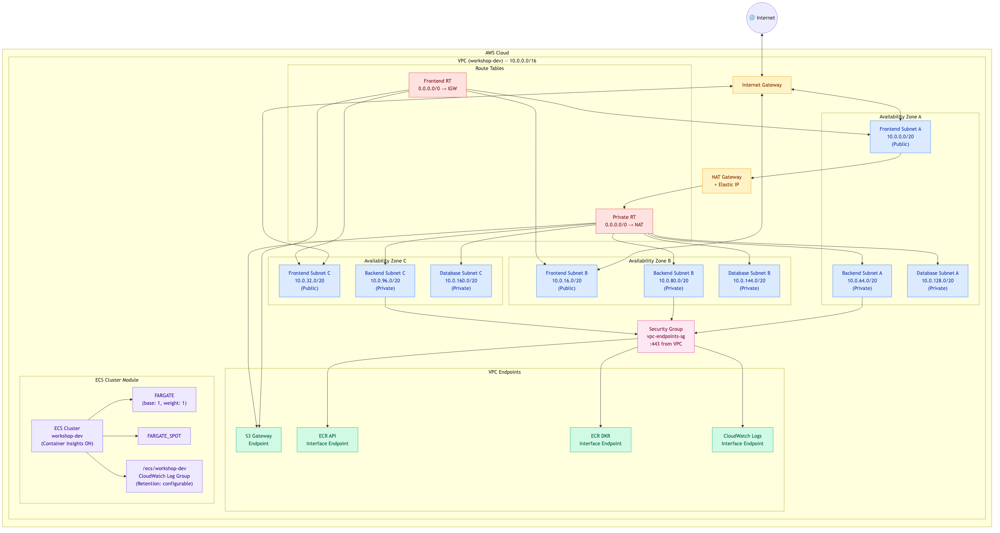
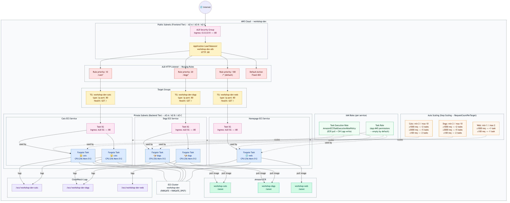

# Claude Code를 활용한 AWS 인프라 관리 및 코드형 인프라(IaC) 워크샵

> **소요 시간:** 약 3시간  
> **대상:** AWS 경험이 있는 초중급 엔지니어  
> **목표:** Claude Code와 Amazon Bedrock을 활용하여 Terraform 기반의 컨테이너 인프라를 설계, 배포, 최적화하는 방법을 학습합니다.

> [!NOTE]
> **리전 변경 안내 (Oregon 리전에서 실습하는 경우)**
>
> 이 워크샵은 **us-east-1 (N. Virginia)** 기준으로 작성되어 있습니다. **us-west-2 (Oregon)** 리전에서 실습하려면 아래 항목을 모두 `us-west-2`로 변경하세요:
>
> - 섹션 2.1: `export AWS_REGION="us-west-2"`
> - 섹션 3.1: settings.json의 `"AWS_REGION": "us-west-2"`
> - 섹션 6.8: terraform.tfvars의 `aws_region = "us-west-2"`, `availability_zones = ["us-west-2a", "us-west-2b"]`
> - 섹션 7.2: ECR 명령어의 `--region us-west-2` 및 ECR URI의 `.ecr.us-west-2.amazonaws.com`
> - 섹션 7.7: app terraform.tfvars의 `aws_region = "us-west-2"`
>
> 모델 ID(`global.anthropic.claude-*`)는 크로스 리전 추론을 사용하므로 변경 불필요합니다.

---

## 목차

1. [Claude Code 설치](#1-claude-code-설치)
2. [AWS 인증 구성](#2-aws-인증-구성)
3. [Bedrock LLM 사용 설정](#3-bedrock-llm-사용-설정)
4. [SKILL.md 생성 — AWS + Terraform + Container](#4-skillmd-생성--aws--terraform--container)
5. [MCP 서버 연결 구성](#5-mcp-서버-연결-구성)
6. [인프라 Terraform 템플릿 생성 및 배포](#6-인프라-terraform-템플릿-생성-및-배포) — VPC, ECS Cluster
7. [Container 기반 애플리케이션 배포를 위한 Terraform 템플릿 생성 및 배포](#7-container-기반-애플리케이션-배포를-위한-terraform-템플릿-생성-및-배포) — Cats & Dogs 멀티 서비스
8. [비용 최적화 및 아키텍처 개선](#8-비용-최적화-및-아키텍처-개선)

---

## 1. Claude Code 설치

### 1.1 Claude Code란?

Claude Code는 Anthropic이 개발한 **에이전틱(agentic) 코딩 도구**입니다. 일반적인 코드 자동완성 도구나 채팅 사이드바와 달리, Claude Code는 터미널에서 직접 동작하며 파일 시스템, 셸 명령, Git에 접근하여 복잡한 멀티 스텝 작업을 자율적으로 수행합니다.

> 공식 문서: https://docs.anthropic.com/en/docs/claude-code/overview

**기존 코딩 도우미와의 차이점:**

| 구분 | 코드 자동완성 (Copilot 등) | Claude Code |
|------|---------------------------|-------------|
| 동작 방식 | 에디터 내 인라인 제안 | 터미널에서 에이전트 루프 실행 |
| 작업 범위 | 현재 파일, 현재 줄 | 전체 코드베이스, 다중 파일 |
| 실행 능력 | 코드 제안만 | 파일 편집 + 명령 실행 + 결과 검증 |
| 상호작용 | 탭으로 수락/거부 | 자연어로 대화하며 작업 위임 |

**핵심 기능:**

- **코드베이스 이해** — 프로젝트 구조를 파악하고, 파일 간 의존관계를 추적
- **파일 읽기/편집/생성** — 다중 파일을 동시에 수정하고 새 파일 생성
- **셸 명령 실행** — 빌드, 테스트, 린트 등 터미널 명령을 직접 실행하고 결과 확인
- **Git 워크플로우** — 커밋, 브랜치 생성, PR 작성 등을 자연어로 처리
- **MCP(Model Context Protocol)** — 외부 도구/API와 연결하여 기능 확장 (Terraform Registry, AWS 문서 등)
- **자율적 반복** — 오류 발생 시 스스로 원인을 분석하고 수정을 반복

**IaC 작업에서의 장점:**

이 워크샵에서 Claude Code를 사용하는 이유는 다음과 같습니다.

1. **Terraform 코드 생성** — 모범 사례에 맞는 모듈 구조를 자연어 설명만으로 생성
2. **즉시 검증** — 생성한 코드를 `terraform validate`, `terraform plan`으로 바로 검증
3. **문서 참조** — MCP를 통해 Terraform Registry의 최신 프로바이더 문서를 실시간 조회
4. **반복 수정** — plan 오류를 분석하고 코드를 자동으로 수정하는 피드백 루프
5. **인프라 분석** — 배포된 리소스 상태를 확인하고 비용/보안 개선점을 제안

### 1.2 사전 요구 사항

| 항목 | 요구 사항 |
|------|-----------|
| Node.js | 18 이상 |
| 운영체제 | macOS, Linux, 또는 Windows(WSL) |
| 터미널 | bash 또는 zsh |

### 1.3 설치

```bash
# npm을 통한 전역 설치
npm install -g @anthropic-ai/claude-code
```

### 1.4 설치 확인

```bash
claude --version
```

정상적으로 버전 정보가 출력되면 설치가 완료된 것입니다.

### 1.5 기본 사용법

```bash
# 대화형 모드 시작
claude
```

> **팁:** Claude Code는 대화형 모드에서 `/help` 명령으로 사용 가능한 슬래시 명령어 목록을 확인할 수 있습니다.

---

## 2. AWS 인증 구성

이 워크샵에서는 사전에 제공된 AWS 자격 증명을 사용합니다.

### 2.1 제공된 자격 증명 설정

워크샵에서 제공하는 AWS 자격 증명을 환경 변수로 설정합니다.

```bash
export AWS_ACCESS_KEY_ID="<워크샵에서 제공된 값>"
export AWS_SECRET_ACCESS_KEY="<워크샵에서 제공된 값>"
export AWS_SESSION_TOKEN="<워크샵에서 제공된 값>"
export AWS_REGION="us-east-1"
```

### 2.2 인증 확인

```bash
aws sts get-caller-identity
```

정상 출력 예시:

```json
{
    "UserId": "AROAEXAMPLEID:workshop-user",
    "Account": "123456789012",
    "Arn": "arn:aws:sts::123456789012:assumed-role/workshop-role/workshop-user"
}
```

### 2.3 Terraform용 AWS 인증

Terraform은 환경 변수에 설정된 AWS 자격 증명을 자동으로 인식합니다. 별도의 추가 설정 없이 `terraform plan` 및 `terraform apply` 명령이 동작합니다.

---

## 3. Bedrock LLM 사용 설정

이 워크샵에서는 워크샵 환경에서 제공하는 Amazon Bedrock 기반의 Claude 모델을 사용합니다.

> [!IMPORTANT]
> **Bedrock Claude 모델 접근을 위한 사전 작업**
>
> Claude LLM을 사용하기 위해서 Bedrock 관리 콘솔에서 **Submit use case details for Anthropic**을 진행해야 합니다.
>
> 1. 강사로부터 전달받은 주소와 인증 정보로 AWS 관리 콘솔로 접속합니다.
> 2. **Bedrock** 서비스로 가서 **Tune → Marketplace model deployments**를 클릭합니다.
> 3. 오른쪽에 **View marketplace models**를 클릭합니다.
> 4. 위에 *"Anthropic requires first-time customers to submit use case details"*로 시작하는 안내가 있습니다. **Submit use case detail**을 클릭합니다.
> 5. 아래와 같이 입력합니다:
>    - **Company name**: `AWS`
>    - **Company website URL**: `https://aws.amazon.com`
>    - **What industry do you operate in?**: `Software as a Service`
>    - **External users** 체크
>    - **Describe**: `AWS training for customer` 입력
> 6. 최종 **Submit use case details**를 클릭하여 제출합니다.

### 3.1 환경 변수 설정

Claude Code가 Amazon Bedrock을 통해 모델을 호출하도록 설정합니다. Claude Code의 설정 파일(`~/.claude/settings.json`)을 아래 내용으로 교체합니다.

```json
{
  "model": "opusplan",
  "env": {
    "CLAUDE_CODE_USE_BEDROCK": "1",
    "AWS_REGION": "us-east-1",
    "ANTHROPIC_DEFAULT_SONNET_MODEL": "global.anthropic.claude-sonnet-4-6",
    "ANTHROPIC_DEFAULT_OPUS_MODEL": "global.anthropic.claude-opus-4-6-v1",
    "ANTHROPIC_DEFAULT_HAIKU_MODEL": "global.anthropic.claude-haiku-4-5-20251001-v1:0"
  }
}
```

**설정 항목 설명:**

| 항목 | 설명 |
|------|------|
| `model` | 기본 실행 모드. `opusplan`은 계획은 Opus, 실행은 Sonnet으로 분리하여 비용 효율적으로 동작 |
| `CLAUDE_CODE_USE_BEDROCK` | `1`로 설정하면 Anthropic API 대신 Bedrock을 통해 모델 호출 |
| `AWS_REGION` | Bedrock 모델을 호출할 AWS 리전 |
| `ANTHROPIC_DEFAULT_SONNET_MODEL` | 코드 작성/실행에 사용할 Sonnet 모델 ID |
| `ANTHROPIC_DEFAULT_OPUS_MODEL` | 고수준 계획 수립에 사용할 Opus 모델 ID |
| `ANTHROPIC_DEFAULT_HAIKU_MODEL` | 간단한 작업에 사용할 경량 Haiku 모델 ID |

> **참고:** `global.` 접두사가 붙은 모델 ID는 Amazon Bedrock의 크로스 리전 추론을 사용합니다. 특정 리전에 용량이 부족할 경우 다른 리전으로 자동 라우팅되어 가용성이 높아집니다. 단일 리전에서만 호출하려면 `us.anthropic.claude-sonnet-4-6`처럼 리전 접두사를 사용합니다.

### 3.2 Claude Code 최초 실행 — 로그인 우회

Claude Code를 처음 실행하면 기본적으로 Anthropic 계정 로그인 위저드가 나타납니다. 하지만 **위 설정 파일에 `CLAUDE_CODE_USE_BEDROCK`이 설정되어 있으면 로그인 위저드가 건너뛰어지고**, AWS 자격 증명을 통해 바로 Bedrock에 연결됩니다.

```bash
# settings.json 설정 완료 후 claude 실행
claude
```

> **중요:** 설정 파일이 적용되지 않거나 로그인 화면이 뜨는 경우, 터미널에서 `export CLAUDE_CODE_USE_BEDROCK=1`을 직접 실행한 후 `claude`를 다시 시작하면 됩니다.

정상적으로 연결되면 프롬프트가 나타나고 바로 대화를 시작할 수 있습니다.

### 3.3 연결 확인

Claude Code 대화형 모드에서 `/status` 명령어를 실행하여 Bedrock 연결 상태를 확인합니다.

```
> /status
```

다음 항목이 올바르게 표시되는지 확인합니다:

| 확인 항목 | 기대 값 |
|-----------|---------|
| API Provider | `Amazon Bedrock` |
| AWS Region | `us-east-1` (설정과 일치) |
| Model | `opusplan` 또는 설정한 모델명 |

출력 예시:

```
API Provider: Amazon Bedrock
Region: us-east-1
Model: opusplan
...
```

> **문제 발생 시:** API Provider가 `Anthropic`으로 표시되거나 리전이 다르면, `Ctrl+C`로 종료한 후 `~/.claude/settings.json` 설정과 AWS 자격 증명 환경 변수를 재확인하세요.

연결이 확인되면 간단한 메시지로 동작을 테스트합니다:

```
> 안녕하세요, Bedrock을 통해 정상적으로 연결되었는지 확인합니다.
```

정상적으로 응답이 오면 Bedrock 연동이 완료된 것입니다.

### 3.4 모델 동작 방식

```
[사용자 터미널] → [Claude Code CLI] → [Amazon Bedrock API] → [Claude 모델]
```

`opusplan` 모드에서는 작업이 두 단계로 나뉩니다:

1. **계획 수립 (Opus)** — 복잡한 작업의 전체 전략을 Opus 모델이 설계
2. **실행 (Sonnet)** — 계획에 따라 Sonnet 모델이 실제 코드 작성/편집 수행

이 방식은 Opus의 고수준 추론 능력과 Sonnet의 빠른 실행 속도를 결합하여, 품질과 비용 효율 사이의 균형을 잡습니다. 간단한 작업(파일 읽기, 짧은 질문 등)에는 경량 Haiku 모델이 자동으로 선택됩니다.

Claude Code는 `CLAUDE_CODE_USE_BEDROCK=1` 설정에 의해 Anthropic API 대신 AWS 자격 증명으로 Amazon Bedrock에 요청을 보내며, 모든 추론이 AWS 보안 경계 내에서 처리됩니다.

---

## 4. SKILL.md 생성 — AWS + Terraform + Container

### 4.1 Skill이란?

#### 왜 Skill을 사용해야 하는가

Claude Code는 범용 에이전트입니다. 코드를 편집하고 명령을 실행할 수 있지만, 여러분 팀의 아키텍처 결정, 네이밍 컨벤션, 배포 방식, 보안 정책을 알지 못합니다. 매번 대화할 때마다 "우리 팀은 Terraform 모듈을 이렇게 구성하고, 태그는 이렇게 붙이고…"라고 반복 설명해야 한다면 비효율적입니다.

**Skill은 이 문제를 해결합니다:**

- **반복 설명 제거** — 프로젝트의 규칙과 패턴을 한 번 작성하면 매 세션마다 자동 적용
- **일관성 보장** — 팀원 누구나 동일한 Skill을 사용하면 동일한 품질의 코드가 생성됨
- **도메인 전문성 주입** — Terraform 모범 사례, AWS 아키텍처 패턴 등을 Claude Code에 "가르침"
- **온보딩 가속** — 신규 팀원이 프로젝트 규칙을 몰라도 Skill이 가이드 역할

#### Agent Skills의 이해

Agent Skill은 Anthropic이 도입한 **조합 가능하고(composable), 이식 가능하며(portable), 필요 시 로드되는(on-demand)** 절차적 지식 캡슐화 메커니즘입니다.

핵심 개념:

- **디렉토리 기반 패키지** — 하나의 폴더에 SKILL.md + 선택적 리소스(문서, 스크립트, 템플릿)를 묶어 하나의 기능 모듈로 구성
- **설명 기반 트리거** — Claude Code는 SKILL.md의 `description`을 읽고, 현재 대화 맥락과 관련이 있을 때 자동으로 해당 Skill을 활성화
- **점진적 공개(Progressive Disclosure)** — 전체 내용을 처음부터 로드하지 않고, 관련성이 있을 때만 전체 지침을 읽어들임

동작 흐름:

```
[사용자 요청] → [Claude Code가 사용 가능한 Skill 목록 스캔]
                          ↓
              [description과 현재 맥락 비교]
                          ↓
              [관련 Skill의 전체 지침 로드]
                          ↓
              [Skill 지침에 따라 코드 생성/작업 수행]
```

#### Skills가 컨텍스트 사용을 최적화하는 방법

AI 에이전트의 컨텍스트 윈도우는 유한한 자원입니다. Skill은 다음과 같이 컨텍스트를 효율적으로 사용합니다:

1. **필요 시 로드(Lazy Loading)** — Claude Code는 SKILL.md의 `name`과 `description`만 먼저 확인합니다. 전체 지침은 해당 Skill이 관련 있다고 판단되었을 때만 로드됩니다.

2. **토큰 경쟁 최소화** — 한 번 로드된 Skill의 모든 토큰은 대화 히스토리와 컨텍스트 공간을 나눠 씁니다. 따라서 SKILL.md는 간결하고 핵심적인 지침만 담아야 합니다.

3. **참조 파일 분리** — 상세한 예제나 템플릿은 별도 파일에 두고 필요 시 참조하도록 구성하면, 기본 컨텍스트 사용량을 줄일 수 있습니다.

4. **재사용 가능한 모듈화** — 하나의 거대한 지시문 대신 여러 작은 Skill로 분리하면, 필요한 것만 선택적으로 활성화됩니다.

> 참고: [Anthropic Skill Authoring Best Practices](https://platform.claude.com/docs/en/agents-and-tools/agent-skills/best-practices)

#### SKILL.md 파일 구조

SKILL.md는 두 부분으로 구성됩니다: **YAML 프론트매터**(메타데이터)와 **마크다운 본문**(지침).

```markdown
---
name: skill-name
description: 이 Skill이 무엇을 하고, 언제 사용해야 하는지 설명 (50~200 단어)
---

# Skill 제목

## 지침 섹션 1
구체적인 규칙과 절차를 마크다운으로 작성

## 지침 섹션 2
추가 규칙과 예시
```

**프론트매터 필드:**

| 필드 | 필수 | 설명 |
|------|------|------|
| `name` | 필수 | Skill 고유 식별자. 소문자, 숫자, 하이픈만 사용 (예: `aws-terraform-container`) |
| `description` | 필수 | Skill의 기능과 트리거 조건. Claude Code가 이 필드를 보고 활성화 여부를 결정하므로 구체적으로 작성 |

**본문 작성 원칙:**

- 프로세스 단계와 규칙만 담을 것 (상세 참조 자료는 별도 파일로 분리)
- 명령형으로 작성 ("~할 것", "~하지 말 것")
- 구체적인 예시를 포함하되 최소한으로 유지
- 섹션을 논리적으로 분리하여 가독성 확보

### 4.2 프로젝트 디렉토리 생성

```bash
mkdir -p ~/workshop-iac && cd ~/workshop-iac
```

### 4.3 Claude Code를 활용한 SKILL.md 생성

Claude Code에게 직접 Skill 파일 작성을 요청합니다.

```bash
claude "이 프로젝트를 위한 SKILL.md 파일을 생성해줘. 
다음 컨텍스트를 반영해:
- AWS 인프라를 Terraform으로 관리
- 컨테이너 워크로드 (ECS Fargate) 중심
- Terraform 모범 사례: 모듈화, 상태 관리(S3 backend), 변수 분리
- AWS 모범 사례: 다중 AZ, 최소 권한 원칙, 태깅 전략
- 코드 구조: environments/ modules/ 분리"
```

> **Challenge:** 생성된 SKILL.md 파일을 읽어보고 더 개선할 부분이 있는지 생각해보세요. [HashiCorp Agent Skills](https://github.com/hashicorp/agent-skills)와 같은 인터넷의 자료를 찾아서 Terraform 관련 모범 사례를 추가로 반영해 보세요.

### 4.4 SKILL.md 예시 구조

아래는 생성될 SKILL.md의 예시입니다.

```markdown
---
name: aws-terraform-container
description: AWS ECS Fargate 인프라를 Terraform으로 관리하기 위한 Skill
---

# AWS + Terraform + Container Skill

## 프로젝트 개요
이 프로젝트는 AWS ECS Fargate 기반의 컨테이너 워크로드를 Terraform으로 프로비저닝하고 관리합니다.

## Terraform 코드 작성 규칙

### 디렉토리 구조
- `modules/` — 재사용 가능한 Terraform 모듈
- `environments/` — 환경별(dev, staging, prod) 구성
- 각 모듈에는 `main.tf`, `variables.tf`, `outputs.tf`를 포함

### 모범 사례
- provider 버전을 고정할 것 (예: `~> 5.0`)
- 리소스에 공통 태그를 적용할 것 (Project, Environment, ManagedBy)
- 민감 변수는 `sensitive = true`로 표시할 것
- 상태 파일은 S3 + DynamoDB로 원격 관리할 것

## AWS 아키텍처 규칙

### 네트워크
- VPC는 최소 2개 AZ에 걸쳐 서브넷을 구성
- 퍼블릭 서브넷: ALB 배치
- 프라이빗 서브넷: ECS 태스크 배치
- NAT Gateway를 통한 아웃바운드 통신

### 컨테이너
- ECS Fargate 사용 (서버리스 컨테이너)
- 태스크 정의에 CPU/메모리 명시
- CloudWatch Logs로 로그 전송
- 서비스당 보안 그룹을 분리

### 보안
- IAM 역할은 최소 권한 원칙 적용
- 보안 그룹은 필요한 포트만 개방
- VPC 엔드포인트 활용으로 프라이빗 통신 유지
```

### 4.5 SKILL.md 적용 확인

```bash
claude "현재 프로젝트의 Skill 내용을 요약해줘"
```

Claude Code가 SKILL.md의 내용을 인식하여 응답하면 정상적으로 적용된 것입니다.

---

## 5. MCP 서버 연결 구성

### 5.1 MCP(Model Context Protocol)란?

MCP는 AI 모델이 외부 도구, 데이터 소스, API에 안전하게 접근할 수 있게 해주는 개방형 표준 프로토콜입니다. Claude Code에 MCP 서버를 연결하면 Terraform Registry 문서 조회, AWS 리소스 탐색 등을 자연어로 수행할 수 있습니다.

#### 왜 MCP를 사용하는가

AI 모델은 학습 데이터 시점까지의 정보만 알고 있습니다. 하지만 인프라 작업에서는 **최신 프로바이더 버전**, **현재 리소스 상태**, **실시간 문서**가 필요합니다. MCP는 이 격차를 해결합니다.

| 문제 | MCP 없이 | MCP 사용 시 |
|------|----------|-------------|
| Terraform 리소스 인자 확인 | 모델 학습 시점의 오래된 정보로 생성 | Registry에서 최신 문서를 실시간 조회 |
| AWS 서비스 설정 옵션 | 부정확하거나 deprecated된 옵션 사용 가능 | 공식 문서에서 현재 유효한 설정 확인 |
| 배포된 리소스 상태 확인 | 사용자가 직접 CLI 결과를 복사/붙여넣기 | 에이전트가 직접 AWS API를 호출하여 확인 |

#### 공식 MCP 서버의 장점

HashiCorp과 AWS Labs에서 제공하는 공식 MCP 서버는 단순한 문서 검색을 넘어, 해당 플랫폼에 특화된 도구와 워크플로우를 제공합니다.

**HashiCorp Terraform MCP Server:**
- Terraform Registry의 프로바이더/모듈 문서를 실시간 조회
- 리소스별 인자(argument), 속성(attribute) 정보를 최신 상태로 제공
- 프라이빗 모듈 레지스트리 연동 지원
- 모델이 추측하지 않고 **공식 스키마에 기반한 정확한 코드**를 생성

> 출처: [Terraform MCP Server — HashiCorp](https://github.com/hashicorp/terraform-mcp-server)

**AWS Labs MCP Servers:**
- ECS 서비스의 전체 라이프사이클(컨테이너화, 배포, 트러블슈팅) 지원
- AWS 공식 문서 검색 및 모범 사례 가이드 제공
- 배포된 리소스 상태를 직접 조회하여 문제 진단 가능
- AWS Well-Architected 관점의 **맥락 있는 권장 사항** 제공

> 출처: [Open Source MCP Servers for AWS](https://awslabs.github.io/mcp/)

요약하면, 공식 MCP 서버를 연결하면 Claude Code가 **"추측하는 에이전트"에서 "검증된 정보에 기반해 행동하는 에이전트"**로 변합니다.

### 5.2 Terraform MCP 서버 구성

Terraform Registry API와 연동되는 MCP Server를 연결합니다. 이 서버는 프로바이더 문서, 리소스 상세 정보, 모듈 메타데이터를 실시간으로 제공합니다.

> 출처: https://github.com/hashicorp/terraform-mcp-server

```bash
# Claude Code에 Terraform MCP 서버 추가
claude mcp add terraform-registry -- npx -y terraform-mcp-server
```

> **참고:** npm 패키지 이름은 `terraform-mcp-server`입니다 (`@hashicorp/` 스코프가 아님). 연결 실패 시 `npx -y terraform-mcp-server`를 직접 실행하여 에러 메시지를 확인하세요.

### 5.3 AWS ECS MCP 서버 구성

AWS Labs에서 제공하는 ECS MCP Server를 연결합니다. 이 서버는 컨테이너 애플리케이션의 배포, 트러블슈팅, 리소스 관리를 지원합니다.

> 출처: https://awslabs.github.io/mcp/servers/ecs-mcp-server

```bash
# Claude Code에 AWS ECS MCP 서버 추가
claude mcp add aws-ecs -- uvx --from awslabs.ecs-mcp-server ecs-mcp-server
```

> **사전 요구:** AWS MCP 서버는 Python 패키지(PyPI)로 배포됩니다. `uvx`가 필요하며, 설치는 `curl -LsSf https://astral.sh/uv/install.sh | sh`로 할 수 있습니다.

### 5.4 AWS Documentation MCP 서버 구성 (선택)

AWS 공식 문서를 검색하고 참조할 수 있는 MCP 서버입니다.

> 출처: https://awslabs.github.io/mcp/servers/aws-documentation-mcp-server

```bash
# Claude Code에 AWS Documentation MCP 서버 추가
claude mcp add aws-docs -- uvx awslabs.aws-documentation-mcp-server
```

### 5.5 MCP 서버 연결 확인

```bash
# 등록된 MCP 서버 목록 확인
claude mcp list
```

출력 예시:

```
terraform-registry: npx -y terraform-mcp-server - ✔ Connected
aws-docs: uvx awslabs.aws-documentation-mcp-server - ✔ Connected
aws-ecs: uvx --from awslabs.ecs-mcp-server ecs-mcp-server - ✔ Connected
```

### 5.6 MCP 서버 동작 테스트

```bash
claude "Terraform AWS provider에서 aws_ecs_cluster 리소스의 설정 옵션을 알려줘"
```

MCP 서버가 정상적으로 연결되어 있으면, Claude Code가 Terraform Registry에서 실시간 문서를 조회하여 최신 정보를 제공합니다.

---

## 6. 인프라 Terraform 템플릿 생성 및 배포

이 섹션에서는 컨테이너 워크로드의 **기반 인프라**(VPC, ECS Cluster)를 프로비저닝합니다. 애플리케이션 서비스와 분리하여 관리함으로써 상태 파일의 blast radius를 줄이고, 인프라 변경 없이 앱을 독립적으로 배포할 수 있습니다.

> **왜 분리하는가?**  
> HashiCorp는 Terraform 상태 파일의 관리 범위를 가능한 한 작게 유지할 것을 권장합니다. 하나의 상태 파일에 모든 리소스를 넣으면, 단일 리소스 변경이 전체 인프라에 영향을 줄 수 있기 때문입니다.  
> 참고: [HashiCorp Workspace Best Practices](https://developer.hashicorp.com/terraform/enterprise/workspaces/best-practices)

### Terraform 파일 역할 설명

Terraform은 관례적으로 기능별로 `.tf` 파일을 분리합니다. 각 파일의 역할은 다음과 같습니다.

| 파일명 | 역할 | 설명 |
|--------|------|------|
| `main.tf` | 리소스 정의 | 실제 AWS 리소스를 선언하는 핵심 파일 |
| `variables.tf` | 입력 변수 선언 | 모듈 외부에서 주입받을 파라미터를 정의 |
| `outputs.tf` | 출력 값 선언 | 다른 모듈이나 상태 파일에서 참조할 값을 내보냄 |
| `providers.tf` | 프로바이더 설정 | AWS provider 버전, 리전, backend 설정 |
| `terraform.tfvars` | 변수 값 할당 | `variables.tf`에 정의된 변수에 실제 값을 대입 |
| `endpoints.tf` | VPC 엔드포인트 | (VPC 모듈 전용) 프라이빗 서비스 연결 정의 |

> **핵심 원칙:** Terraform은 디렉토리 내 모든 `.tf` 파일을 자동으로 병합하여 하나의 구성으로 처리합니다. 파일 분리는 순전히 가독성과 유지보수를 위한 것이며, 기능적 차이는 없습니다.

### 모듈(modules)과 환경(environments) 분리 패턴

```
infra/
├── modules/          ← 재사용 가능한 "설계도" (무엇을 만들 것인가)
│   ├── vpc/
│   └── ecs-cluster/
└── environments/     ← 환경별 "실행 구성" (어떤 값으로 만들 것인가)
    └── dev/
```

- **modules/** — 리소스의 구조를 정의합니다. 변수로 파라미터화되어 있어 여러 환경에서 재사용 가능합니다.
- **environments/** — 특정 환경(dev, staging, prod)에 맞는 구체적인 값을 넣어 모듈을 호출합니다.

이 패턴의 장점:
- 동일 모듈로 `dev`, `staging`, `prod` 환경을 각각 독립 배포 가능
- 모듈 수정 시 모든 환경에 일관되게 반영
- 환경별 상태 파일이 분리되어 blast radius 최소화

### 6.1 전체 프로젝트 구조

```
~/workshop-iac/
├── SKILL.md
├── infra/                        # 인프라 템플릿 (이 섹션)
│   ├── modules/
│   │   ├── vpc/
│   │   └── ecs-cluster/
│   ├── environments/
│   │   └── dev/
│   └── README.md
├── app/                          # 애플리케이션 템플릿 (다음 섹션)
│   ├── modules/
│   │   ├── alb/
│   │   └── ecs-service/
│   ├── environments/
│   │   └── dev/
│   └── README.md
└── README.md
```

### 6.2 아키텍처 설계 원칙

컨테이너 워크로드에 최적화된 VPC는 아래 AWS 모범 사례를 따릅니다.

| 원칙 | 설명 |
|------|------|
| 다중 AZ 배치 | 최소 2개 가용 영역에 서브넷을 분산하여 고가용성 확보 |
| 퍼블릭/프라이빗 서브넷 분리 | ALB는 퍼블릭, ECS 태스크는 프라이빗 서브넷에 배치 |
| NAT Gateway | 프라이빗 서브넷의 아웃바운드 인터넷 통신 지원 |
| VPC 엔드포인트 | ECR, S3, CloudWatch Logs 등 AWS 서비스에 프라이빗 접근 |
| 적정 CIDR 설계 | 향후 확장을 고려한 IP 주소 공간 할당 |

> 참고: [AWS VPC 보안 모범 사례](https://docs.aws.amazon.com/vpc/latest/userguide/vpc-security-best-practices.html), [Amazon ECS 서비스 연결 모범 사례](https://docs.aws.amazon.com/AmazonECS/latest/developerguide/networking-connecting-services.html)

### 6.3 인프라 템플릿에 포함되는 리소스

인프라 템플릿은 네트워크와 클러스터 등 기반 리소스를 관리합니다.

| 리소스 | 역할 |
|--------|------|
| VPC + 서브넷 | 네트워크 격리 및 가용 영역 분산 |
| Internet Gateway + NAT Gateway | 인터넷 통신 |
| ECS Cluster | Fargate 태스크 실행 환경 |
| VPC 엔드포인트 | ECR, S3, CloudWatch Logs 프라이빗 접근 |

### 6.4 Claude Code로 인프라 모듈 생성

> **Challenge:** 아래의 코드를 그대로 실행해도 좋습니다. 하지만 Well-Architected Framework 관점에서 개선해야 할 부분이 있지 않을까요? 한번 생각해보시고 프롬프트를 수정해서 요청해보세요.

```bash
cd ~/workshop-iac
mkdir -p infra

claude "infra/ 디렉토리에 컨테이너 워크로드 기반 인프라 Terraform 템플릿을 생성해줘.

요구사항:
- infra/modules/vpc/ — VPC 모듈
  - 2개 AZ에 퍼블릭/프라이빗 서브넷 배치
  - NAT Gateway (단일 — 워크샵 비용 절감)
  - VPC 엔드포인트 (ECR API, ECR DKR, S3, CloudWatch Logs)
  - CIDR 기본값 10.0.0.0/16

- infra/modules/ecs-cluster/ — ECS Cluster 모듈
  - Fargate 용량 공급자 설정
  - Container Insights 활성화
  - CloudWatch Log Group

- infra/environments/dev/ — 환경 구성
  - 위 모듈들을 호출
  - backend는 local (워크샵용)
  - provider 버전 고정 (~> 5.0)
  - outputs.tf에 app 템플릿이 참조할 값들 출력
    (vpc_id, public_subnet_ids, private_subnet_ids, ecs_cluster_id)

- 공통 태그: Project=workshop, Environment=dev, ManagedBy=terraform
- Terraform AWS provider 모범 사례 적용"
```

### 6.5 생성될 파일 구조

```
infra/
├── modules/
│   ├── vpc/
│   │   ├── main.tf           # VPC, 서브넷, IGW, NAT GW, 라우트 테이블
│   │   ├── endpoints.tf      # VPC 엔드포인트 (ECR, S3, CloudWatch Logs)
│   │   ├── variables.tf      # 입력 변수 (CIDR, AZ 등)
│   │   └── outputs.tf        # 출력 값 (vpc_id, subnet_ids 등)
│   └── ecs-cluster/
│       ├── main.tf           # ECS Cluster, Fargate 용량 공급자
│       ├── variables.tf      # 입력 변수
│       └── outputs.tf        # 출력 값 (cluster_id, cluster_name)
├── environments/
│   └── dev/
│       ├── main.tf           # 모듈 호출 (VPC, ECS Cluster)
│       ├── variables.tf      # 환경별 변수 정의
│       ├── outputs.tf        # app 템플릿이 참조할 출력 값
│       ├── terraform.tfvars  # 환경별 변수 값 (리전, CIDR 등)
│       └── providers.tf      # AWS provider 및 backend 설정
└── README.md
```

### 6.6 예제 코드 — VPC 모듈

Claude Code가 생성하는 코드의 예시입니다. 실제로는 프롬프트에 따라 코드가 달라질 수 있습니다.

**infra/modules/vpc/variables.tf**

```hcl
variable "project_name" {
  description = "프로젝트 이름"
  type        = string
}

variable "environment" {
  description = "환경 (dev, staging, prod)"
  type        = string
}

variable "vpc_cidr" {
  description = "VPC CIDR 블록"
  type        = string
  default     = "10.0.0.0/16"
}

variable "availability_zones" {
  description = "사용할 가용 영역 목록"
  type        = list(string)
  default     = ["us-east-1a", "us-east-1b"]
}

variable "public_subnet_cidrs" {
  description = "퍼블릭 서브넷 CIDR 목록"
  type        = list(string)
  default     = ["10.0.1.0/24", "10.0.2.0/24"]
}

variable "private_subnet_cidrs" {
  description = "프라이빗 서브넷 CIDR 목록"
  type        = list(string)
  default     = ["10.0.10.0/24", "10.0.20.0/24"]
}

variable "tags" {
  description = "공통 태그"
  type        = map(string)
  default     = {}
}
```

**infra/modules/vpc/main.tf**

```hcl
# VPC 생성 — 컨테이너 워크로드를 위한 격리된 네트워크
resource "aws_vpc" "this" {
  cidr_block           = var.vpc_cidr
  enable_dns_hostnames = true  # ECS 서비스 디스커버리에 필요
  enable_dns_support   = true  # VPC 내부 DNS 확인 활성화

  tags = merge(var.tags, {
    Name = "${var.project_name}-${var.environment}-vpc"
  })
}

# 퍼블릭 서브넷 — ALB가 배치될 인터넷 접근 가능 서브넷
resource "aws_subnet" "public" {
  count                   = length(var.public_subnet_cidrs)
  vpc_id                  = aws_vpc.this.id
  cidr_block              = var.public_subnet_cidrs[count.index]
  availability_zone       = var.availability_zones[count.index]
  map_public_ip_on_launch = true  # 퍼블릭 IP 자동 할당

  tags = merge(var.tags, {
    Name = "${var.project_name}-${var.environment}-public-${count.index + 1}"
    Tier = "Public"
  })
}

# 프라이빗 서브넷 — ECS 태스크가 배치될 인터넷 비노출 서브넷
resource "aws_subnet" "private" {
  count             = length(var.private_subnet_cidrs)
  vpc_id            = aws_vpc.this.id
  cidr_block        = var.private_subnet_cidrs[count.index]
  availability_zone = var.availability_zones[count.index]

  tags = merge(var.tags, {
    Name = "${var.project_name}-${var.environment}-private-${count.index + 1}"
    Tier = "Private"
  })
}

# Internet Gateway — VPC의 인터넷 연결 게이트웨이
resource "aws_internet_gateway" "this" {
  vpc_id = aws_vpc.this.id

  tags = merge(var.tags, {
    Name = "${var.project_name}-${var.environment}-igw"
  })
}

# NAT Gateway용 Elastic IP — 고정 퍼블릭 IP 할당
resource "aws_eip" "nat" {
  domain = "vpc"

  tags = merge(var.tags, {
    Name = "${var.project_name}-${var.environment}-nat-eip"
  })
}

# NAT Gateway (단일) — 프라이빗 서브넷의 아웃바운드 인터넷 통신 담당
# 프로덕션에서는 AZ당 1개씩 배치하여 고가용성 확보 권장
resource "aws_nat_gateway" "this" {
  allocation_id = aws_eip.nat.id
  subnet_id     = aws_subnet.public[0].id  # 첫 번째 퍼블릭 서브넷에 배치

  tags = merge(var.tags, {
    Name = "${var.project_name}-${var.environment}-nat"
  })

  depends_on = [aws_internet_gateway.this]  # IGW 생성 후 NAT 생성
}

# 퍼블릭 라우트 테이블 — 인터넷 트래픽을 IGW로 라우팅
resource "aws_route_table" "public" {
  vpc_id = aws_vpc.this.id

  route {
    cidr_block = "0.0.0.0/0"          # 모든 외부 트래픽
    gateway_id = aws_internet_gateway.this.id  # IGW로 전달
  }

  tags = merge(var.tags, {
    Name = "${var.project_name}-${var.environment}-public-rt"
  })
}

# 퍼블릭 서브넷과 라우트 테이블 연결
resource "aws_route_table_association" "public" {
  count          = length(aws_subnet.public)
  subnet_id      = aws_subnet.public[count.index].id
  route_table_id = aws_route_table.public.id
}

# 프라이빗 라우트 테이블 — 외부 트래픽을 NAT Gateway로 라우팅
resource "aws_route_table" "private" {
  vpc_id = aws_vpc.this.id

  route {
    cidr_block     = "0.0.0.0/0"           # 모든 외부 트래픽
    nat_gateway_id = aws_nat_gateway.this.id  # NAT GW로 전달
  }

  tags = merge(var.tags, {
    Name = "${var.project_name}-${var.environment}-private-rt"
  })
}

# 프라이빗 서브넷과 라우트 테이블 연결
resource "aws_route_table_association" "private" {
  count          = length(aws_subnet.private)
  subnet_id      = aws_subnet.private[count.index].id
  route_table_id = aws_route_table.private.id
}
```

**infra/modules/vpc/endpoints.tf**

```hcl
# ECR API 엔드포인트 — 컨테이너 이미지 메타데이터 조회를 VPC 내부에서 처리
resource "aws_vpc_endpoint" "ecr_api" {
  vpc_id              = aws_vpc.this.id
  service_name        = "com.amazonaws.${data.aws_region.current.name}.ecr.api"
  vpc_endpoint_type   = "Interface"          # ENI 기반 프라이빗 연결
  subnet_ids          = aws_subnet.private[*].id
  security_group_ids  = [aws_security_group.vpc_endpoints.id]
  private_dns_enabled = true                 # 기존 DNS 이름으로 프라이빗 접근

  tags = merge(var.tags, {
    Name = "${var.project_name}-${var.environment}-ecr-api-endpoint"
  })
}

# ECR DKR 엔드포인트 — 컨테이너 이미지 레이어 다운로드를 VPC 내부에서 처리
resource "aws_vpc_endpoint" "ecr_dkr" {
  vpc_id              = aws_vpc.this.id
  service_name        = "com.amazonaws.${data.aws_region.current.name}.ecr.dkr"
  vpc_endpoint_type   = "Interface"
  subnet_ids          = aws_subnet.private[*].id
  security_group_ids  = [aws_security_group.vpc_endpoints.id]
  private_dns_enabled = true

  tags = merge(var.tags, {
    Name = "${var.project_name}-${var.environment}-ecr-dkr-endpoint"
  })
}

# S3 Gateway 엔드포인트 — ECR 이미지 레이어 저장소(S3) 접근, 무료
resource "aws_vpc_endpoint" "s3" {
  vpc_id            = aws_vpc.this.id
  service_name      = "com.amazonaws.${data.aws_region.current.name}.s3"
  vpc_endpoint_type = "Gateway"              # 라우트 테이블 기반, 추가 비용 없음
  route_table_ids   = [aws_route_table.private.id]

  tags = merge(var.tags, {
    Name = "${var.project_name}-${var.environment}-s3-endpoint"
  })
}

# CloudWatch Logs 엔드포인트 — 컨테이너 로그 전송을 VPC 내부에서 처리
resource "aws_vpc_endpoint" "logs" {
  vpc_id              = aws_vpc.this.id
  service_name        = "com.amazonaws.${data.aws_region.current.name}.logs"
  vpc_endpoint_type   = "Interface"
  subnet_ids          = aws_subnet.private[*].id
  security_group_ids  = [aws_security_group.vpc_endpoints.id]
  private_dns_enabled = true

  tags = merge(var.tags, {
    Name = "${var.project_name}-${var.environment}-logs-endpoint"
  })
}

# VPC 엔드포인트용 보안 그룹 — VPC 내부에서 HTTPS(443) 접근만 허용
resource "aws_security_group" "vpc_endpoints" {
  name_prefix = "${var.project_name}-${var.environment}-vpce-"
  vpc_id      = aws_vpc.this.id

  ingress {
    from_port   = 443
    to_port     = 443
    protocol    = "tcp"
    cidr_blocks = [var.vpc_cidr]  # VPC 내부 트래픽만 허용
  }

  tags = merge(var.tags, {
    Name = "${var.project_name}-${var.environment}-vpce-sg"
  })
}

# 현재 리전 정보를 가져오기 위한 데이터 소스
data "aws_region" "current" {}
```

**infra/modules/vpc/outputs.tf**

```hcl
output "vpc_id" {
  description = "VPC ID"
  value       = aws_vpc.this.id
}

output "public_subnet_ids" {
  description = "퍼블릭 서브넷 ID 목록"
  value       = aws_subnet.public[*].id
}

output "private_subnet_ids" {
  description = "프라이빗 서브넷 ID 목록"
  value       = aws_subnet.private[*].id
}

output "vpc_cidr_block" {
  description = "VPC CIDR 블록"
  value       = aws_vpc.this.cidr_block
}
```

### 6.7 예제 코드 — ECS Cluster 모듈

**infra/modules/ecs-cluster/main.tf**

```hcl
# ECS 클러스터 — Fargate 태스크를 실행하는 논리적 그룹
resource "aws_ecs_cluster" "this" {
  name = "${var.project_name}-${var.environment}-cluster"

  # Container Insights — CPU/메모리/네트워크 메트릭 수집 활성화
  setting {
    name  = "containerInsights"
    value = "enabled"
  }

  tags = merge(var.tags, {
    Name = "${var.project_name}-${var.environment}-cluster"
  })
}

# 용량 공급자 설정 — Fargate와 Fargate Spot을 모두 사용 가능하도록 구성
resource "aws_ecs_cluster_capacity_providers" "this" {
  cluster_name       = aws_ecs_cluster.this.name
  capacity_providers = ["FARGATE", "FARGATE_SPOT"]

  # 기본 전략: FARGATE를 기본으로 사용, base=1은 최소 1개 태스크를 FARGATE로 실행
  default_capacity_provider_strategy {
    capacity_provider = "FARGATE"
    weight            = 1
    base              = 1
  }
}
```

### 6.8 예제 코드 — 환경 구성 (dev)

**infra/environments/dev/providers.tf**

```hcl
terraform {
  required_version = ">= 1.5.0"

  required_providers {
    aws = {
      source  = "hashicorp/aws"
      version = "~> 5.0"
    }
  }

  # 워크샵용 로컬 백엔드
  backend "local" {
    path = "terraform.tfstate"
  }
}

provider "aws" {
  region = var.aws_region

  default_tags {
    tags = {
      Project     = var.project_name
      Environment = var.environment
      ManagedBy   = "terraform"
    }
  }
}
```

**infra/environments/dev/main.tf**

```hcl
module "vpc" {
  source = "../../modules/vpc"

  project_name       = var.project_name
  environment        = var.environment
  vpc_cidr           = var.vpc_cidr
  availability_zones = var.availability_zones
  tags               = local.tags
}

module "ecs_cluster" {
  source = "../../modules/ecs-cluster"

  project_name = var.project_name
  environment  = var.environment
  tags         = local.tags
}

locals {
  tags = {
    Project     = var.project_name
    Environment = var.environment
    ManagedBy   = "terraform"
  }
}
```

**infra/environments/dev/outputs.tf**

```hcl
output "vpc_id" {
  value = module.vpc.vpc_id
}

output "private_subnet_ids" {
  value = module.vpc.private_subnet_ids
}

output "public_subnet_ids" {
  value = module.vpc.public_subnet_ids
}

output "ecs_cluster_id" {
  value = module.ecs_cluster.cluster_id
}

output "ecs_cluster_name" {
  value = module.ecs_cluster.cluster_name
}
```

**infra/environments/dev/terraform.tfvars**

```hcl
project_name       = "workshop"
environment        = "dev"
aws_region         = "us-east-1"
vpc_cidr           = "10.0.0.0/16"
availability_zones = ["us-east-1a", "us-east-1b"]
```

### 6.9 Terraform 배포

```bash
cd infra/environments/dev

# 초기화
terraform init

# 실행 계획 확인
terraform plan

# 배포 (확인 후 진행)
terraform apply
```

### 6.10 배포 결과 확인 및 출력값 기록

```bash
# 출력값 확인 — app 템플릿에서 참조할 값들
terraform output
```

출력 예시:

```
ecs_cluster_id = "arn:aws:ecs:us-east-1:123456789012:cluster/workshop-cluster"
ecs_cluster_name = "workshop-dev-cluster"
private_subnet_ids = ["subnet-0aaa...", "subnet-0bbb..."]
public_subnet_ids = ["subnet-0ccc...", "subnet-0ddd..."]
vpc_id = "vpc-0123..."
```

```bash
# Claude Code로 배포 결과 검증
claude "방금 배포한 인프라의 리소스 상태를 확인하고, 
보안 관점에서 개선할 점이 있는지 분석해줘"
```

### 6.11 아키텍처 다이어그램 생성 — 인프라

> **Challenge:** 방금 전 Terraform으로 생성한 인프라 아키텍처를 mermaid 다이어그램으로 변환하고 이미지를 생성해주세요.
>
> **힌트:** Claude Code를 위한 Mermaid MCP 서버가 있습니다.
>
> 강사가 생성한 이미지를 업로드할 게시판을 알려줄 것입니다. 그곳으로 올려주세요.

**예시 결과물:**



---

## 7. Container 기반 애플리케이션 배포를 위한 Terraform 템플릿 생성 및 배포

이 섹션에서는 인프라 위에 **Cats & Dogs** 멀티 서비스 애플리케이션을 배포합니다. ALB의 경로 기반 라우팅으로 `/cats`와 `/dogs` 요청을 각각 별도의 ECS 서비스로 분기하고, 서비스별 독립적인 Auto Scaling을 구성합니다.

> **참고:** 이 실습은 [aws-samples/amazon-ecs-catsndogs-workshop](https://github.com/aws-samples/amazon-ecs-catsndogs-workshop)의 아키텍처 패턴을 Terraform + Fargate 버전으로 구현한 것입니다.

### 7.1 애플리케이션 아키텍처

```
                         ┌──────────────────────────────────────────────────┐
                         │                      ALB                          │
                         │           (앱 템플릿에서 생성)                     │
                         └───────┬──────────────┬──────────────┬────────────┘
                                 │              │              │
                    ┌────────────▼──┐   ┌───────▼──────┐   ┌──▼────────────┐
                    │  /cats* 경로   │   │  /dogs* 경로  │   │  /* 기본 경로  │
                    │  Target Group  │   │  Target Group │   │  Target Group │
                    └────────┬──────┘   └───────┬──────┘   └──┬────────────┘
                             │                  │              │
                    ┌────────▼──────┐   ┌───────▼──────┐   ┌──▼────────────┐
                    │ Cats Service   │   │ Dogs Service  │   │ Web Service   │
                    │ (ECS Fargate)  │   │ (ECS Fargate) │   │ (ECS Fargate) │
                    │ desired: 2     │   │ desired: 2    │   │ desired: 1    │
                    │ max: 10        │   │ max: 10       │   │ max: 2        │
                    └────────────────┘   └──────────────┘   └───────────────┘
```

**분리의 이점:**
- Cats와 Dogs 서비스를 독립적으로 스케일링 가능
- 한 서비스의 장애가 다른 서비스에 영향을 주지 않음
- 서비스별 배포/롤백이 가능

### 7.2 샘플 애플리케이션 준비 및 ECR 푸시

ECS에 배포할 컨테이너 이미지를 준비합니다. Cats & Dogs 샘플 애플리케이션을 클론하고, ECR에 푸시합니다.

#### 7.2.1 샘플 리포지토리 클론

```bash
git clone https://github.com/solminkim/ecs-cats-dogs.git
```

리포지토리 구조:

```
ecs-cats-dogs/
├── cats/               # Cats 서비스 (nginx + 고양이 이미지 페이지)
│   ├── Dockerfile
│   ├── default.conf    # nginx 설정 (/cats 경로 서빙)
│   └── index.html
├── dogs/               # Dogs 서비스 (nginx + 강아지 이미지 페이지)
│   ├── Dockerfile
│   ├── default.conf    # nginx 설정 (/dogs 경로 서빙)
│   └── index.html
├── web/                # Homepage 서비스 (cats/dogs 링크 페이지)
│   ├── Dockerfile
│   ├── default.conf
│   └── index.html
└── service_loadtest.sh # 부하 테스트 스크립트
```

#### 7.2.2 ECR 리포지토리 생성

Claude Code에게 ECR 리포지토리 생성을 요청합니다.

```bash
claude "AWS ECR 리포지토리 3개를 생성해주세요: workshop-cats, workshop-dogs, workshop-web.
terraform 템플릿을 통해서 생성하고, 이미지 스캔은 활성화해주세요."
```

또는 AWS ECR API로 직접 실행:

```bash
# ECR 리포지토리 생성 (cats, dogs, web)
for repo in workshop-cats workshop-dogs workshop-web; do
  aws ecr create-repository \
    --repository-name $repo \
    --image-scanning-configuration scanOnPush=true \
    --region us-east-1
done
```

#### 7.2.3 Docker 이미지 빌드 및 ECR 푸시

```bash
# ECR 로그인
AWS_ACCOUNT_ID=$(aws sts get-caller-identity --query Account --output text)
aws ecr get-login-password --region us-east-1 | \
  docker login --username AWS --password-stdin ${AWS_ACCOUNT_ID}.dkr.ecr.us-east-1.amazonaws.com

# Cats 이미지 빌드 & 푸시
cd ecs-cats-dogs/cats
docker build -t workshop-cats .
docker tag workshop-cats:latest ${AWS_ACCOUNT_ID}.dkr.ecr.us-east-1.amazonaws.com/workshop-cats:latest
docker push ${AWS_ACCOUNT_ID}.dkr.ecr.us-east-1.amazonaws.com/workshop-cats:latest
```

> **Challenge:** 이제 dogs 서비스와 web (Homepage) 서비스를 위한 Docker 이미지를 빌드하고 푸시해주세요.
>
> **힌트:** Cats 이미지 빌드 & 푸시 명령어를 참고해주세요.


> **팁:** 위 과정을 Claude Code에게 한 번에 맡길 수도 있습니다:
> ```bash
> claude "ecs-cats-dogs 디렉토리의 cats, dogs, web 각각을 Docker 빌드해서 
> ECR에 푸시하는 스크립트를 작성하고 실행해줘. 리전은 us-east-1이야."
> ```

#### 7.2.4 푸시 결과 확인

```bash
# 각 리포지토리에 이미지가 정상적으로 올라갔는지 확인
for repo in workshop-cats workshop-dogs workshop-web; do
  echo "=== $repo ==="
  aws ecr describe-images --repository-name $repo --query 'imageDetails[0].imageTags'
done
```

이후 Terraform ECS Task Definition에서 이 ECR 이미지 URI를 참조합니다:
- `${AWS_ACCOUNT_ID}.dkr.ecr.us-east-1.amazonaws.com/workshop-cats:latest`
- `${AWS_ACCOUNT_ID}.dkr.ecr.us-east-1.amazonaws.com/workshop-dogs:latest`
- `${AWS_ACCOUNT_ID}.dkr.ecr.us-east-1.amazonaws.com/workshop-web:latest`

### 7.3 인프라 출력값 참조 방식

애플리케이션 템플릿은 인프라 템플릿의 상태 파일에서 출력값을 읽어옵니다.

```hcl
# app/environments/dev/data.tf
data "terraform_remote_state" "infra" {
  backend = "local"
  config = {
    path = "../../../infra/environments/dev/terraform.tfstate"
  }
}
```

이렇게 하면 인프라와 애플리케이션 간의 의존성을 명시적으로 관리하면서도, 각각 독립적으로 `plan`/`apply`할 수 있습니다.

### 7.4 Claude Code로 ECS 서비스 모듈 생성

```bash
claude "app/ 디렉토리에 ECS Fargate 애플리케이션 Terraform 템플릿을 생성해줘.

아키텍처:
- Cats & Dogs 두 개의 독립 서비스를 ALB 경로 기반 라우팅으로 분기
- /cats → Cats 서비스 (Target Group A)
- /dogs → Dogs 서비스 (Target Group B)
- / → Web 서비스 (Target Group C)

모듈 구조:
- app/modules/alb/ — ALB 모듈
  - Application Load Balancer (퍼블릭 서브넷 배치)
  - HTTP Listener (기본 응답: 404 fixed response)
  - ALB 보안 그룹 (80 포트 인바운드 허용)

- app/modules/ecs-service/ — 재사용 가능한 ECS 서비스 모듈
  - ECS Task Definition (Fargate)
  - ECS Service
  - Target Group + ALB Listener Rule (경로 기반)
  - Auto Scaling (RequestCount 기반 Step Scaling)
  - IAM: Task Execution Role, Task Role
  - ECS 태스크용 보안 그룹
  - CloudWatch Log Group

- app/environments/dev/ — 환경 구성
  - terraform_remote_state로 infra 출력값 참조
  - ALB 모듈 호출 (퍼블릭 서브넷에 배치)
  - cats 서비스: 이미지 ECR(workshop-cats), 경로 /cats*, desired 2, max 10
  - dogs 서비스: 이미지 ECR(workshop-dogs), 경로 /dogs*, desired 2, max 10
  - web 서비스: 이미지 ECR(workshop-web), 경로 기본(/*), desired 1, max 2
  - 각 서비스별 Step Scaling 정책:
    - Scale Up: RequestCount >= 1000 → +2 tasks, >= 3000 → +5 tasks
    - Scale Down: RequestCount <= 100 → -2 tasks
  - backend는 local (워크샵용)

- 각 서비스는 같은 모듈을 다른 파라미터로 호출 (DRY 원칙)
- 보안 그룹: ALB에서 ECS 태스크로의 트래픽만 허용
- Fargate CPU: 256, 메모리: 512
- 공통 태그: Project=workshop, Environment=dev, ManagedBy=terraform"
```

### 7.5 생성될 파일 구조

```
app/
├── modules/
│   └── ecs-service/
│       ├── main.tf          # Task Definition, Service
│       ├── alb.tf           # Target Group, Listener Rule
│       ├── iam.tf           # Task Execution Role, Task Role
│       ├── security.tf      # 보안 그룹
│       ├── autoscaling.tf   # Step Scaling 정책
│       ├── logging.tf       # CloudWatch Log Group
│       ├── variables.tf     # 입력 변수
│       └── outputs.tf       # 출력 값
├── environments/
│   └── dev/
│       ├── main.tf          # 3개 서비스 모듈 호출
│       ├── data.tf          # terraform_remote_state 참조
│       ├── variables.tf
│       ├── outputs.tf
│       ├── terraform.tfvars
│       └── providers.tf
└── README.md
```

### 7.6 예제 코드 — ECS 서비스 모듈

**app/modules/ecs-service/variables.tf**

```hcl
variable "service_name" {
  description = "서비스 이름 (cats, dogs, web 등)"
  type        = string
}

variable "project_name" {
  description = "프로젝트 이름"
  type        = string
}

variable "environment" {
  description = "환경 (dev, staging, prod)"
  type        = string
}

variable "container_image" {
  description = "컨테이너 이미지 URI"
  type        = string
  default     = "nginx:latest"
}

variable "container_port" {
  description = "컨테이너 포트"
  type        = number
  default     = 80
}

variable "cpu" {
  description = "Fargate CPU 단위 (256, 512, 1024, 2048, 4096)"
  type        = number
  default     = 256
}

variable "memory" {
  description = "Fargate 메모리 (MB)"
  type        = number
  default     = 512
}

variable "desired_count" {
  description = "원하는 태스크 수"
  type        = number
  default     = 2
}

variable "min_count" {
  description = "Auto Scaling 최소 태스크 수"
  type        = number
  default     = 2
}

variable "max_count" {
  description = "Auto Scaling 최대 태스크 수"
  type        = number
  default     = 10
}

variable "path_pattern" {
  description = "ALB 리스너 규칙 경로 패턴"
  type        = list(string)
}

variable "priority" {
  description = "ALB 리스너 규칙 우선순위 (낮을수록 먼저 매칭)"
  type        = number
  default     = 10
}

variable "vpc_id" {
  description = "VPC ID"
  type        = string
}

variable "private_subnet_ids" {
  description = "프라이빗 서브넷 ID 목록"
  type        = list(string)
}

variable "alb_listener_arn" {
  description = "ALB Listener ARN"
  type        = string
}

variable "alb_security_group_id" {
  description = "ALB 보안 그룹 ID"
  type        = string
}

variable "ecs_cluster_id" {
  description = "ECS Cluster ID"
  type        = string
}

variable "tags" {
  description = "공통 태그"
  type        = map(string)
  default     = {}
}
```

**app/modules/ecs-service/main.tf**

```hcl
# ECS Task Definition — 컨테이너 실행 사양을 정의
resource "aws_ecs_task_definition" "this" {
  family                   = "${var.project_name}-${var.environment}-${var.service_name}"
  network_mode             = "awsvpc"           # Fargate 필수: 태스크별 ENI 할당
  requires_compatibilities = ["FARGATE"]        # Fargate 전용 태스크
  cpu                      = var.cpu            # vCPU 단위 (256 = 0.25 vCPU)
  memory                   = var.memory         # MB 단위
  execution_role_arn       = aws_iam_role.execution.arn  # ECR 풀, 로그 쓰기 권한
  task_role_arn            = aws_iam_role.task.arn       # 앱이 사용할 AWS 서비스 권한

  # 컨테이너 정의 — JSON 형태로 컨테이너 설정
  container_definitions = jsonencode([
    {
      name  = var.service_name
      image = var.container_image
      portMappings = [
        {
          containerPort = var.container_port
          protocol      = "tcp"
        }
      ]
      # CloudWatch Logs로 컨테이너 로그 전송
      logConfiguration = {
        logDriver = "awslogs"
        options = {
          "awslogs-group"         = aws_cloudwatch_log_group.this.name
          "awslogs-region"        = data.aws_region.current.name
          "awslogs-stream-prefix" = var.service_name
        }
      }
      essential = true  # 이 컨테이너가 종료되면 태스크 전체 종료
    }
  ])

  tags = merge(var.tags, {
    Name = "${var.project_name}-${var.environment}-${var.service_name}-task"
  })
}

# ECS Service — 태스크의 원하는 수를 유지하고 ALB와 연결
resource "aws_ecs_service" "this" {
  name            = "${var.project_name}-${var.environment}-${var.service_name}"
  cluster         = var.ecs_cluster_id
  task_definition = aws_ecs_task_definition.this.arn
  desired_count   = var.desired_count           # 유지할 태스크 수
  launch_type     = "FARGATE"

  # 네트워크 설정 — 프라이빗 서브넷에 배치, 퍼블릭 IP 없음
  network_configuration {
    subnets          = var.private_subnet_ids
    security_groups  = [aws_security_group.task.id]
    assign_public_ip = false  # NAT Gateway를 통해 외부 통신
  }

  # ALB Target Group과 연결 — 트래픽 수신 설정
  load_balancer {
    target_group_arn = aws_lb_target_group.this.arn
    container_name   = var.service_name
    container_port   = var.container_port
  }

  depends_on = [aws_lb_listener_rule.this]  # 리스너 규칙 생성 후 서비스 배포

  tags = merge(var.tags, {
    Name = "${var.project_name}-${var.environment}-${var.service_name}-service"
  })
}

data "aws_region" "current" {}
```

**app/modules/ecs-service/alb.tf**

```hcl
# Target Group — ECS 태스크를 ALB 뒤에 등록하는 그룹
resource "aws_lb_target_group" "this" {
  name        = "${var.project_name}-${var.environment}-${var.service_name}"
  port        = var.container_port
  protocol    = "HTTP"
  vpc_id      = var.vpc_id
  target_type = "ip"  # Fargate는 IP 타입 필수 (awsvpc 네트워크 모드)

  # 헬스체크 — ALB가 태스크 정상 여부를 주기적으로 확인
  health_check {
    enabled             = true
    healthy_threshold   = 3      # 3번 연속 성공 시 healthy
    unhealthy_threshold = 3      # 3번 연속 실패 시 unhealthy
    timeout             = 5      # 응답 대기 시간 (초)
    interval            = 30     # 헬스체크 주기 (초)
    path                = "/"    # 헬스체크 경로
    matcher             = "200-399"  # 성공으로 간주할 HTTP 상태 코드
  }

  tags = merge(var.tags, {
    Name = "${var.project_name}-${var.environment}-${var.service_name}-tg"
  })
}

# ALB Listener Rule — URL 경로에 따라 요청을 적절한 Target Group으로 라우팅
resource "aws_lb_listener_rule" "this" {
  listener_arn = var.alb_listener_arn
  priority     = var.priority  # 숫자가 낮을수록 먼저 매칭됨

  action {
    type             = "forward"
    target_group_arn = aws_lb_target_group.this.arn
  }

  # 경로 패턴 조건 — /cats*, /dogs* 등 URL 경로로 분기
  condition {
    path_pattern {
      values = var.path_pattern
    }
  }

  tags = var.tags
}
```

**app/modules/ecs-service/iam.tf**

```hcl
# Task Execution Role — ECS 에이전트가 사용하는 역할
# ECR에서 이미지 풀, CloudWatch Logs에 로그 쓰기 등 인프라 작업 수행
resource "aws_iam_role" "execution" {
  name = "${var.project_name}-${var.environment}-${var.service_name}-exec-role"

  # ECS 태스크 서비스가 이 역할을 assume 할 수 있도록 허용
  assume_role_policy = jsonencode({
    Version = "2012-10-17"
    Statement = [
      {
        Action = "sts:AssumeRole"
        Effect = "Allow"
        Principal = {
          Service = "ecs-tasks.amazonaws.com"
        }
      }
    ]
  })

  tags = var.tags
}

# AWS 관리형 정책 연결 — ECR 풀 + CloudWatch Logs 쓰기 권한 포함
resource "aws_iam_role_policy_attachment" "execution" {
  role       = aws_iam_role.execution.name
  policy_arn = "arn:aws:iam::aws:policy/service-role/AmazonECSTaskExecutionRolePolicy"
}

# Task Role — 컨테이너 내부 애플리케이션 코드가 사용하는 역할
# 필요 시 여기에 S3, DynamoDB 등 추가 권한을 부여
resource "aws_iam_role" "task" {
  name = "${var.project_name}-${var.environment}-${var.service_name}-task-role"

  assume_role_policy = jsonencode({
    Version = "2012-10-17"
    Statement = [
      {
        Action = "sts:AssumeRole"
        Effect = "Allow"
        Principal = {
          Service = "ecs-tasks.amazonaws.com"
        }
      }
    ]
  })

  tags = var.tags
}
```

**app/modules/ecs-service/security.tf**

```hcl
# ECS 태스크 보안 그룹 — ALB에서 오는 트래픽만 허용 (최소 권한 원칙)
resource "aws_security_group" "task" {
  name_prefix = "${var.project_name}-${var.environment}-${var.service_name}-task-"
  vpc_id      = var.vpc_id

  # 인바운드: ALB 보안 그룹에서 컨테이너 포트로의 트래픽만 허용
  ingress {
    description     = "Allow traffic from ALB"
    from_port       = var.container_port
    to_port         = var.container_port
    protocol        = "tcp"
    security_groups = [var.alb_security_group_id]  # IP 대신 보안 그룹 참조
  }

  # 아웃바운드: 모든 외부 통신 허용 (ECR 이미지 풀, 외부 API 호출 등)
  egress {
    from_port   = 0
    to_port     = 0
    protocol    = "-1"
    cidr_blocks = ["0.0.0.0/0"]
  }

  tags = merge(var.tags, {
    Name = "${var.project_name}-${var.environment}-${var.service_name}-task-sg"
  })
}
```

**app/modules/ecs-service/autoscaling.tf**

```hcl
# Auto Scaling Target — ECS 서비스의 태스크 수를 스케일링 대상으로 등록
resource "aws_appautoscaling_target" "this" {
  max_capacity       = var.max_count
  min_capacity       = var.min_count
  resource_id        = "service/${split("/", var.ecs_cluster_id)[1]}/${aws_ecs_service.this.name}"
  scalable_dimension = "ecs:service:DesiredCount"  # 스케일링할 속성: 태스크 수
  service_namespace  = "ecs"
}

# Scale Up 정책 (Step Scaling) — 요청 수에 따라 단계별로 태스크 추가
resource "aws_appautoscaling_policy" "scale_up" {
  name               = "${var.service_name}-scale-up"
  policy_type        = "StepScaling"
  resource_id        = aws_appautoscaling_target.this.resource_id
  scalable_dimension = aws_appautoscaling_target.this.scalable_dimension
  service_namespace  = aws_appautoscaling_target.this.service_namespace

  step_scaling_policy_configuration {
    adjustment_type         = "ChangeInCapacity"  # 절대값으로 태스크 수 조정
    cooldown                = 60                  # 스케일링 후 60초 대기
    metric_aggregation_type = "Average"

    # 1단계: 임계값 초과 ~ +2000 범위이면 태스크 2개 추가
    step_adjustment {
      metric_interval_lower_bound = 0
      metric_interval_upper_bound = 2000
      scaling_adjustment          = 2
    }

    # 2단계: +2000 이상이면 태스크 5개 추가 (급격한 트래픽 증가 대응)
    step_adjustment {
      metric_interval_lower_bound = 2000
      scaling_adjustment          = 5
    }
  }
}

# Scale Down 정책 — 트래픽 감소 시 태스크 제거
resource "aws_appautoscaling_policy" "scale_down" {
  name               = "${var.service_name}-scale-down"
  policy_type        = "StepScaling"
  resource_id        = aws_appautoscaling_target.this.resource_id
  scalable_dimension = aws_appautoscaling_target.this.scalable_dimension
  service_namespace  = aws_appautoscaling_target.this.service_namespace

  step_scaling_policy_configuration {
    adjustment_type         = "ChangeInCapacity"
    cooldown                = 120                 # 스케일 다운은 더 보수적으로 (120초 대기)
    metric_aggregation_type = "Average"

    # 임계값 이하이면 태스크 2개 제거
    step_adjustment {
      metric_interval_upper_bound = 0
      scaling_adjustment          = -2
    }
  }
}

# Scale Up CloudWatch Alarm — Target Group당 요청 수가 1000 이상이면 트리거
resource "aws_cloudwatch_metric_alarm" "scale_up" {
  alarm_name          = "${var.project_name}-${var.environment}-${var.service_name}-scale-up"
  comparison_operator = "GreaterThanOrEqualToThreshold"
  evaluation_periods  = 2       # 2분 연속 임계값 초과 시 알람
  metric_name         = "RequestCountPerTarget"
  namespace           = "AWS/ApplicationELB"
  period              = 60      # 1분 단위 측정
  statistic           = "Sum"
  threshold           = 1000    # Target Group당 1000 요청/분

  dimensions = {
    TargetGroup  = aws_lb_target_group.this.arn_suffix
  }

  alarm_actions = [aws_appautoscaling_policy.scale_up.arn]

  tags = var.tags
}

# Scale Down CloudWatch Alarm — 요청 수가 100 이하로 떨어지면 트리거
resource "aws_cloudwatch_metric_alarm" "scale_down" {
  alarm_name          = "${var.project_name}-${var.environment}-${var.service_name}-scale-down"
  comparison_operator = "LessThanOrEqualToThreshold"
  evaluation_periods  = 3       # 3분 연속 임계값 이하 시 알람 (보수적)
  metric_name         = "RequestCountPerTarget"
  namespace           = "AWS/ApplicationELB"
  period              = 60
  statistic           = "Sum"
  threshold           = 100

  dimensions = {
    TargetGroup  = aws_lb_target_group.this.arn_suffix
  }

  alarm_actions = [aws_appautoscaling_policy.scale_down.arn]

  tags = var.tags
}
```

**app/modules/ecs-service/logging.tf**

```hcl
# CloudWatch Log Group — 컨테이너 stdout/stderr 로그 수집
resource "aws_cloudwatch_log_group" "this" {
  name              = "/ecs/${var.project_name}-${var.environment}-${var.service_name}"
  retention_in_days = 7  # 워크샵용 7일 보관 (프로덕션에서는 30일 이상 권장)

  tags = merge(var.tags, {
    Name = "${var.project_name}-${var.environment}-${var.service_name}-logs"
  })
}
```

**app/modules/ecs-service/outputs.tf**

```hcl
output "service_name" {
  description = "ECS 서비스 이름"
  value       = aws_ecs_service.this.name
}

output "target_group_arn" {
  description = "Target Group ARN"
  value       = aws_lb_target_group.this.arn
}

output "task_definition_arn" {
  description = "Task Definition ARN"
  value       = aws_ecs_task_definition.this.arn
}

output "security_group_id" {
  description = "태스크 보안 그룹 ID"
  value       = aws_security_group.task.id
}
```

### 7.7 예제 코드 — 환경 구성 (dev)

**app/environments/dev/data.tf**

```hcl
# 인프라 템플릿의 상태 파일에서 출력값 참조
# 인프라(VPC, ECS Cluster)가 먼저 배포되어 있어야 함
data "terraform_remote_state" "infra" {
  backend = "local"
  config = {
    path = "../../../infra/environments/dev/terraform.tfstate"
  }
}
```

**app/environments/dev/main.tf**

```hcl
# Cats 서비스 — /cats* 경로로 들어오는 요청 처리
module "cats" {
  source = "../../modules/ecs-service"

  service_name          = "cats"
  project_name          = var.project_name
  environment           = var.environment
  container_image       = "${var.aws_account_id}.dkr.ecr.us-east-1.amazonaws.com/workshop-cats:latest"
  container_port        = 80
  cpu                   = 256                  # 0.25 vCPU
  memory                = 512                  # 512 MB
  desired_count         = 2                    # 평상시 2개 태스크 유지
  min_count             = 2                    # 최소 2개 (고가용성)
  max_count             = 10                   # 최대 10개까지 스케일 아웃
  path_pattern          = ["/cats*"]           # ALB 경로 패턴
  priority              = 10                   # 리스너 규칙 우선순위 (낮을수록 먼저)
  vpc_id                = data.terraform_remote_state.infra.outputs.vpc_id
  private_subnet_ids    = data.terraform_remote_state.infra.outputs.private_subnet_ids
  alb_listener_arn      = module.alb.alb_listener_arn
  alb_security_group_id = module.alb.alb_security_group_id
  ecs_cluster_id        = data.terraform_remote_state.infra.outputs.ecs_cluster_id
  tags                  = local.tags
}

# Dogs 서비스 — /dogs* 경로로 들어오는 요청 처리
module "dogs" {
  source = "../../modules/ecs-service"

  service_name          = "dogs"
  project_name          = var.project_name
  environment           = var.environment
  container_image       = "${var.aws_account_id}.dkr.ecr.us-east-1.amazonaws.com/workshop-dogs:latest"
  container_port        = 80
  cpu                   = 256
  memory                = 512
  desired_count         = 2
  min_count             = 2
  max_count             = 10
  path_pattern          = ["/dogs*"]
  priority              = 20                   # cats보다 낮은 우선순위
  vpc_id                = data.terraform_remote_state.infra.outputs.vpc_id
  private_subnet_ids    = data.terraform_remote_state.infra.outputs.private_subnet_ids
  alb_listener_arn      = module.alb.alb_listener_arn
  alb_security_group_id = module.alb.alb_security_group_id
  ecs_cluster_id        = data.terraform_remote_state.infra.outputs.ecs_cluster_id
  tags                  = local.tags
}

# Web 서비스 — 기본 라우팅 (나머지 모든 경로)
module "web" {
  source = "../../modules/ecs-service"

  service_name          = "web"
  project_name          = var.project_name
  environment           = var.environment
  container_image       = "${var.aws_account_id}.dkr.ecr.us-east-1.amazonaws.com/workshop-web:latest"
  container_port        = 80
  cpu                   = 256
  memory                = 512
  desired_count         = 1                    # 홈페이지는 1개로 충분
  min_count             = 1
  max_count             = 2
  path_pattern          = ["/*"]               # 모든 경로 매칭 (catch-all)
  priority              = 100                  # 가장 낮은 우선순위 (다른 규칙에 안 걸린 요청만)
  vpc_id                = data.terraform_remote_state.infra.outputs.vpc_id
  private_subnet_ids    = data.terraform_remote_state.infra.outputs.private_subnet_ids
  alb_listener_arn      = module.alb.alb_listener_arn
  alb_security_group_id = module.alb.alb_security_group_id
  ecs_cluster_id        = data.terraform_remote_state.infra.outputs.ecs_cluster_id
  tags                  = local.tags
}

locals {
  tags = {
    Project     = var.project_name
    Environment = var.environment
    ManagedBy   = "terraform"
  }
}
```

**app/environments/dev/providers.tf**

```hcl
terraform {
  required_version = ">= 1.5.0"

  required_providers {
    aws = {
      source  = "hashicorp/aws"
      version = "~> 5.0"
    }
  }

  backend "local" {
    path = "terraform.tfstate"
  }
}

provider "aws" {
  region = var.aws_region

  default_tags {
    tags = {
      Project     = var.project_name
      Environment = var.environment
      ManagedBy   = "terraform"
    }
  }
}
```

**app/environments/dev/outputs.tf**

```hcl
output "cats_service_name" {
  value = module.cats.service_name
}

output "dogs_service_name" {
  value = module.dogs.service_name
}

output "web_service_name" {
  value = module.web.service_name
}

output "alb_dns_name" {
  value = module.alb.alb_dns_name
}
```

**app/environments/dev/terraform.tfvars**

```hcl
project_name = "workshop"
environment  = "dev"
aws_region   = "us-east-1"
```

### 7.8 핵심 구성 패턴 — 모듈 재사용

위 예제 코드에서 볼 수 있듯이, 동일한 `ecs-service` 모듈을 서비스별로 다른 파라미터로 호출합니다. 이것이 Terraform 모듈의 핵심 가치인 **DRY(Don't Repeat Yourself)** 원칙입니다. 새로운 서비스를 추가하려면 모듈 호출 블록 하나만 추가하면 됩니다.

### 7.9 Terraform 배포

```bash
cd app/environments/dev

# 초기화
terraform init

# 실행 계획 확인
terraform plan

# 배포
terraform apply
```

### 7.10 최종 애플리케이션 아키텍처

배포가 완료되면 아래와 같은 아키텍처가 구성됩니다.



### 7.11 배포 확인

```bash
# 앱 출력에서 ALB DNS 확인
cd ~/workshop-iac/app/environments/dev
ALB_DNS=$(terraform output -raw alb_dns_name)

# 각 서비스 경로 접근 테스트
curl http://$ALB_DNS/
curl http://$ALB_DNS/cats
curl http://$ALB_DNS/dogs
```

> **Challenge:** 배포 이후에 강아지 사진이 나오는 dogs 서비스, 고양이 사진이 나오는 cats 서비스 화면을 스크린샷을 찍어서 게시판에 올려주세요.
>
> 강사가 업로드할 게시판을 알려줄 것입니다. 그곳으로 올려주세요.

### 7.12 Auto Scaling 동작 테스트

```bash
claude "배포된 cats와 dogs 서비스에 부하를 줘서 
Auto Scaling이 정상 동작하는지 확인하는 방법을 알려줘.
간단한 부하 테스트 스크립트를 생성해줘."
```

간단한 부하 테스트 예시:

```bash
# cats 서비스에 부하 발생 (별도 터미널에서 실행)
for i in $(seq 1 1000); do
  curl -s -o /dev/null http://$ALB_DNS/cats
done

# ECS 서비스 태스크 수 변화 확인
aws ecs describe-services \
  --cluster workshop-cluster \
  --services cats \
  --query "services[0].{desired:desiredCount,running:runningCount}"
```

### 7.13 Claude Code로 배포 상태 종합 확인

```bash
claude "배포된 ECS 서비스들의 상태를 종합 확인해줘:
- cats, dogs, web 각 서비스의 태스크 실행 상태
- ALB 리스너 규칙이 경로별로 올바르게 구성되었는지
- 각 Target Group의 헬스체크 상태
- Auto Scaling 정책이 올바르게 설정되었는지"
```

---

## 8. 비용 최적화 및 아키텍처 개선

### 8.1 Claude Code를 활용한 비용 분석

```bash
claude "현재 배포된 인프라의 예상 월간 비용을 분석하고,
비용 최적화 방안을 제시해줘.

다음 관점에서 분석해줘:
1. NAT Gateway 비용 절감 방안
2. Fargate Spot 활용 가능성
3. VPC 엔드포인트를 통한 데이터 전송 비용 절감
4. 적정 CPU/메모리 사이징"
```

### 8.2 주요 비용 최적화 전략

| 전략 | 설명 | 예상 절감 |
|------|------|-----------|
| Fargate Spot | 중단 허용 워크로드에 Spot 적용 | 최대 70% |
| NAT Gateway 최적화 | VPC 엔드포인트로 AWS 서비스 트래픽 우회 | 데이터 처리 비용 절감 |
| 적정 사이징 | CloudWatch 메트릭 기반 CPU/메모리 조정 | 10~30% |
| Auto Scaling | 트래픽 기반 자동 스케일링으로 유휴 리소스 제거 | 가변적 |

### 8.3 아키텍처 개선 제안

```bash
claude "현재 인프라 구성에서 프로덕션 환경으로 발전시키려면
어떤 부분을 개선해야 하는지 분석해줘.

다음 관점에서 제안해줘:
1. 보안 강화 (WAF, Secrets Manager 등)
2. 모니터링/알람 (CloudWatch, X-Ray)
3. CI/CD 파이프라인 통합
4. 다중 환경(dev/staging/prod) 관리 전략
5. 재해 복구(DR) 고려사항"
```

### 8.4 Terraform 코드 개선 적용

```bash
claude "다음 개선사항을 Terraform 코드에 적용해줘:
1. Fargate Spot 용량 공급자 추가 (Spot 70%, On-Demand 30% 비율)
2. Container Insights 활성화
3. ALB 액세스 로그 S3 버킷 설정"
```

### 8.5 리소스 정리

워크샵이 끝난 후 비용 발생을 방지하기 위해 리소스를 정리합니다. **애플리케이션 → 인프라 순서**로 삭제해야 합니다.

```bash
# 1. 애플리케이션 리소스 먼저 삭제 (ECS 서비스, ALB, ECR 등)
cd ~/workshop-iac/app/environments/dev
terraform destroy

# 2. 인프라 리소스 삭제 (VPC, ECS Cluster 등)
cd ~/workshop-iac/infra/environments/dev
terraform destroy
```

> **주의:** 삭제 순서가 중요합니다. 인프라를 먼저 삭제하면 애플리케이션이 참조하는 리소스가 사라져 상태 불일치가 발생합니다. ECR 리포지토리를 Terraform이 아닌 CLI로 생성한 경우, 아래 명령으로 별도 삭제해야 합니다. 프로덕션 환경에서는 `terraform destroy`를 절대 함부로 사용하지 마세요.
>
> ```bash
> # ECR을 CLI로 생성한 경우에만 실행
> for repo in workshop-cats workshop-dogs workshop-web; do
>   aws ecr delete-repository --repository-name $repo --force --region us-east-1
> done
> ```

---

## 부록

### A. 참고 자료

| 주제 | 링크 |
|------|------|
| Terraform AWS Provider 모범 사례 (AWS) | https://docs.aws.amazon.com/prescriptive-guidance/latest/terraform-aws-provider-best-practices/introduction.html |
| Terraform 코드 구조 모범 사례 (AWS) | https://docs.aws.amazon.com/prescriptive-guidance/latest/terraform-aws-provider-best-practices/structure.html |
| Terraform 권장 사례 (HashiCorp) | https://developer.hashicorp.com/terraform/enterprise/workspaces/best-practices |
| AWS ECS 모범 사례 | https://docs.aws.amazon.com/AmazonECS/latest/bestpracticesguide/intro.html |
| AWS VPC 보안 모범 사례 | https://docs.aws.amazon.com/vpc/latest/userguide/vpc-security-best-practices.html |
| Terraform MCP Server (HashiCorp) | https://github.com/hashicorp/terraform-mcp-server |
| AWS MCP Servers (AWS Labs) | https://awslabs.github.io/mcp/ |
| Claude Code 공식 문서 | https://docs.anthropic.com/en/docs/claude-code/overview |
| AWS Integration & Automation Terraform 표준 | https://aws-ia.github.io/standards-terraform/ |
| ECS Cats & Dogs 워크샵 (원본 참고) | https://github.com/aws-samples/amazon-ecs-catsndogs-workshop |

### B. 트러블슈팅

#### Claude Code가 Bedrock에 연결되지 않을 때

```bash
# 환경 변수 확인
echo $CLAUDE_CODE_USE_BEDROCK
echo $AWS_REGION

# AWS 자격 증명 유효성 확인
aws sts get-caller-identity

# Bedrock 모델 액세스 권한 확인
aws bedrock list-foundation-models --query "modelSummaries[?contains(modelId, 'claude')]" --output table
```

#### Terraform init 실패 시

```bash
# 플러그인 캐시 초기화
rm -rf .terraform .terraform.lock.hcl
terraform init
```

#### ECS 태스크 시작 실패 시

```bash
# 태스크 중지 사유 확인
aws ecs describe-tasks \
  --cluster <cluster-name> \
  --tasks <task-arn> \
  --query "tasks[0].stoppedReason"

# Claude Code로 문제 분석
claude "ECS 태스크가 시작 실패했어. 중지 사유는 '<사유>'야. 원인과 해결 방법을 알려줘"
```

### C. 워크샵 종료 체크리스트

- [ ] `terraform destroy`로 앱 리소스 삭제 완료 (app/environments/dev — ECR 포함)
- [ ] `terraform destroy`로 인프라 리소스 삭제 완료 (infra/environments/dev)
- [ ] AWS 콘솔에서 리소스가 정리되었는지 확인
- [ ] 로컬의 AWS 자격 증명 환경 변수 해제

```bash
unset AWS_ACCESS_KEY_ID
unset AWS_SECRET_ACCESS_KEY
unset AWS_SESSION_TOKEN
unset CLAUDE_CODE_USE_BEDROCK
```

---

> **수고하셨습니다!** 이 워크샵을 통해 Claude Code와 Terraform을 활용하여 AWS 컨테이너 인프라를 효율적으로 관리하는 방법을 학습했습니다.
